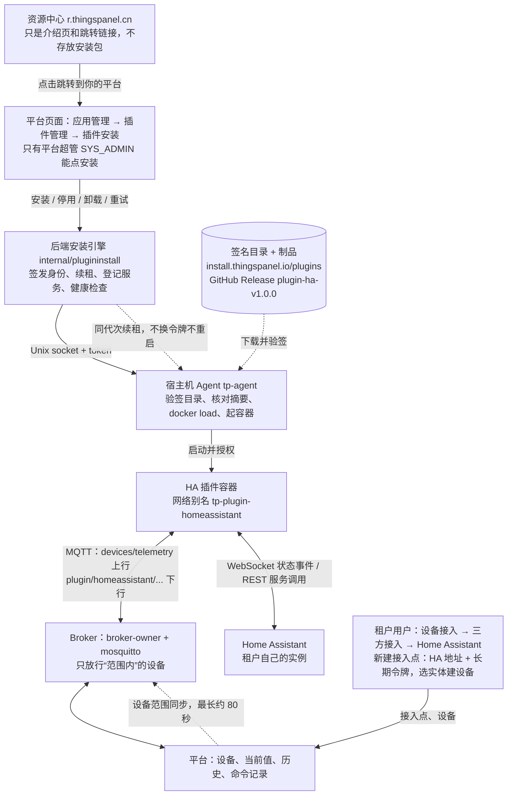
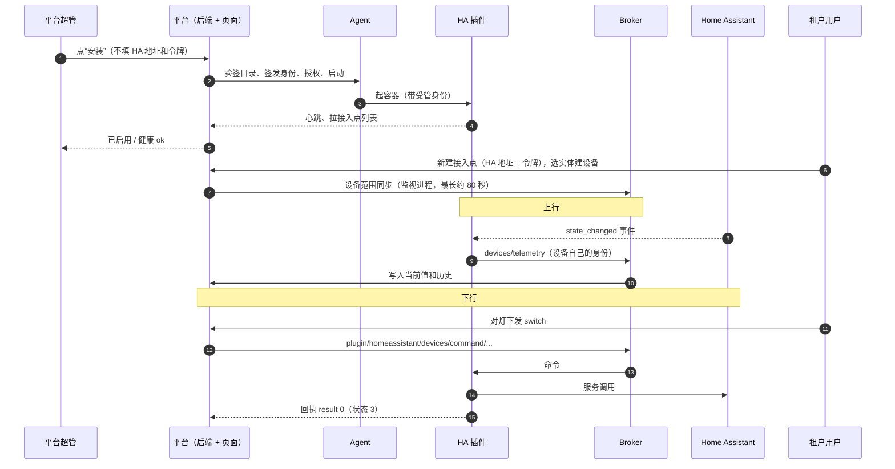
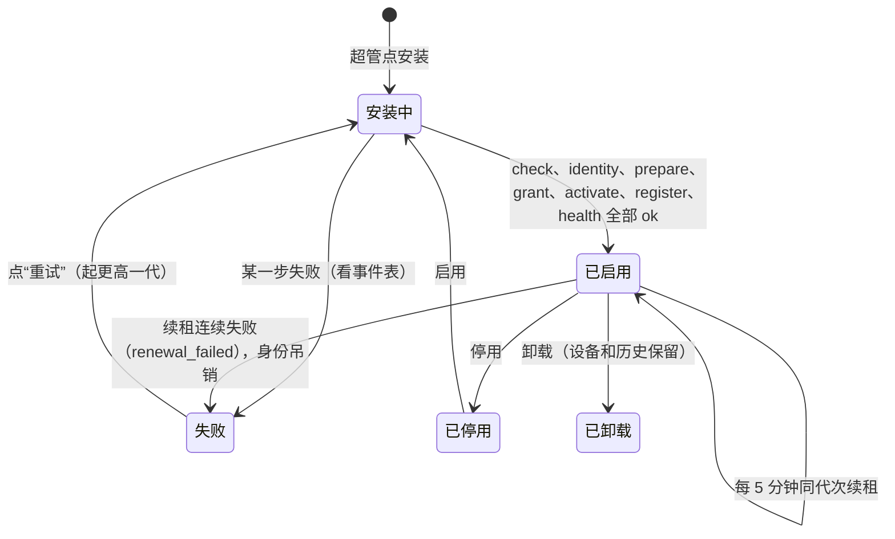

# HA 插件一键安装 — 测试移交入口

> **从这里开始读。** 读完这一份你就知道：要测什么、被测的东西在哪、环境怎么来、怎么测、哪些问题已知。
> 更细的步骤在 [`ha-plugin-handover/TEST-CASES.md`](ha-plugin-handover/TEST-CASES.md)；**负责发布镜像的人看 [`HA-PLUGIN-PUBLISH-TASK.md`](HA-PLUGIN-PUBLISH-TASK.md)**。
> 文档日期 2026-11-09。状态会变，**动手前先跑 §6 的两个体检脚本**，别全信文字。

## 0. 三十秒版

- **在测什么**：Home Assistant（下面简称 HA）是“第三方服务插件”的第一个样例。平台**超管**在页面上点一下就装好插件（安装时不填 HA 地址、不填令牌）；装好后，**每个租户**在自己的“接入点”里填自己的 HA 地址和令牌，选 HA 实体建成设备，实现 **上行**（HA 状态进平台）和 **下行**（平台开关灯、HA 跟着变、平台收到回执）。
- **你要做的**：按 [`TEST-CASES.md`](ha-plugin-handover/TEST-CASES.md) 的 A 组（安装）和 B 组（租户接入与数据）逐条做，每条留证据，失败的写清楚现象，**不要在这个任务里修代码**。
- **别做的**：不推送、不合并、不发布；不删别人的容器/卷/目录；HA 令牌不进日志、截图、聊天（§8）。
- **三个最大的坑，开工前先看**：
  1. **现成的验收栈现在是坏的**：HA 插件安装记录是 `failed / renewal_failed`，最新一代身份已吊销。它跑的后端代码来自一个**不在任何分支上**的提交，而且比 develop 少了续租修复。**别直接拿它当“好环境”，先看 §4。**
  2. **干净机器路径目前走不通**：公开安装器默认装的后端和前端镜像（`v1.3.0`）里**没有**插件安装接口和页面，带插件安装功能的镜像还没发布（§4.2）。
  3. **租户那一半（B 组）从没在页面上完整验证过**：历史上的上行下行是用 API 模拟建设备测的（§3）。

## 1. 整件事是怎么串起来的

**图 1：总览流程图**（谁装、装到哪、数据怎么走。GitHub 上会直接渲染成图）



**图 2：一次完整的上行和下行（时序）**



**图 3：失败时的状态（安装记录）**



> 简版文字链路：资源中心（只跳转）→ 平台“插件安装”页（超管）→ 后端安装引擎 → 宿主机 Agent（验签、起容器）→ HA 插件容器 ⇄ Broker ⇄ 平台；租户在“三方接入”里配自己的接入点和设备；插件 ⇄ Home Assistant。

要点：
- **签名目录** 决定能装什么。目录由官方私钥签名，Agent 用**包外**的公钥验签；篡改过的目录或镜像必须被拒绝。
- **身份** 是后端按“代次（generation）”签发给插件容器的令牌，会定期**续租**（同代次、令牌不变、不重启容器）；吊销后插件调平台被拒。
- **Broker 设备范围**：平台账号和插件账号只能碰“范围内”的设备。新建 HA 设备后范围要刷新，否则下行命令会被 Broker 静默丢弃（安装器有个监视进程自动做，最长约 80 秒）。

## 2. 被测的东西在哪（六个仓库）

| 部分 | 仓库 / 位置 | 要看的分支 / 提交 | 状态 |
|---|---|---|---|
| 后端（安装引擎、身份、API） | `thingspanel-backend-community` | 本地 `develop` @ `c0ab14d1`（含续租修复）；回移到发布线的候选 `wp/t7-ha-release-backport` @ `91b1e958` | **都没合入远端**；远端 develop 是 `9d071b7`，与本地 develop 不是同一条线（见 §4.3） |
| 前端（插件安装页、租户接入点入口） | `thingspanel-frontend-wp-pui`（前端仓库 worktree） | `wp/pui-frontend` @ `c40ad217` | 未合入；这个 worktree 有 4 个未提交的路由文件，别覆盖 |
| 安装器 + Agent | `thingspanel-installer` | `wp/t6-ha-public-release` @ `1f2f5a96`（已推送同名远端分支）；公网站点由 `codex/ha-plugin-public-site-20261108` @ `72946f1` 发布 | 公开安装入口和插件目录**已上线**（§6 脚本可验证） |
| HA 插件 | `thingspanel-device-connector-homeassistant` | 发布的 `1.0.0` = 提交 `0b3240e`，在分支 `wp/t6-ha-public-artifact`（本地） | **不要用该仓库 `main` 目录测**：`main` 有未提交的新改动（`ha_actions.go` 等），不属于已发布版本 |
| SDK | `thingspanel-device-connector-sdk-go` | `v1.1.0` @ `fa39f24e`（被发布版本引用） | — |
| 官方制品 | GitHub Release `plugin-ha-v1.0.0` + `https://install.thingspanel.io/plugins/catalog-linux-{amd64,arm64}.json` | amd64 + arm64 | 已公开，签名/摘要已核验（§6） |

公钥指纹（目录验签用，写在安装器里，不是从目录里取）：`6f6e902e807b86949e9dc3090de82eb932c27c6bd7f95987c8f44de00cca4fe8`。

> 看到 `docs/WORKSPACES.md` 里的各种 `wp-*` 目录别慌：上表是**被测对象的最小集合**，其他目录是历史工作线，不用管，也**不要删**。

## 3. 现状红绿灯（别把“旧版本通过”当成“当前版本通过”）

| 能力 | 状态 | 依据（读之前注意它们说的是哪个版本） |
|---|---|---|
| 超管页面一键安装 HA（候选 r2，临时测试签名） | ✅ 通过，含 30 分钟稳定观察 | [`tasks/HA-PLUGIN-RELEASE-INSTALL-2026-11-06-DONE.md`](tasks/HA-PLUGIN-RELEASE-INSTALL-2026-11-06-DONE.md) |
| 用**公开 1.0.0 签名目录**在页面安装 | ⚠️ 装成功过一次（2026-11-08 12:47，gen5 健康 ok），之后 16:01 起续租失败变 `failed` | 验收栈数据库事件表（§4.1 能复现这个查询） |
| 公开制品签名 / 摘要 / 篡改拒绝 | ✅ 2026-11-09 实测通过（amd64、arm64） | `tools/verify-public-release.sh` |
| 公网下载 → Agent → 插件 `/health`（隔离、无平台） | ✅ 通过（仅 arm64 实跑） | `tasks/T6-DISTRIBUTION-DONE.md`（在安装器仓库 `wp/t6-plugin-distribution`） |
| 真实 HA 上行 + 下行 | ✅ 历史通过：2026-11-04，手工做了迁移、刷新 Broker 范围、重启；建设备用 API 模拟 | [`tasks/T7b-DONE.md`](tasks/T7b-DONE.md) |
| 租户账号在**页面**里新建接入点、选实体、建设备 | ✅ 2026-11-09 实测通过（演示 HA，租户 A；共 33 个实体，页面 10 个一页，勾选跨页保留） | 整理时现场操作；旧记录见 [`tasks/PLUGIN-UI-DONE.md`](tasks/PLUGIN-UI-DONE.md) §4.8 |
| 超管安装 + 租户接入点 + 上下行整条链（develop 后端 + develop Broker + 公开 1.0.0 插件） | ✅ 2026-11-09 实测：上行（HA 温度改为 43.3，平台当前值 43.3）、下行（灯 off→on→off，两次回执状态 3、`result:0`）。**只做了一次，没有长跑，用的是演示 HA 不是真实设备** | 现场操作；任务卡见 [`HA-PLUGIN-TASKS-2026-11-06.md`](HA-PLUGIN-TASKS-2026-11-06.md) |
| 两个租户互相隔离 | ✅ 2026-11-09 实测：租户 B 设备列表为空；对 A 的设备下发命令返回“device not found”，读 A 的遥测返回“无访问权限” | 现场操作；单测见 `tasks/T4-DONE.md` |
| amd64 真实运行 | ❌ 只验过签名和摘要，没真起过 | — |
| MySQL | ❌ 未验证（发行版只有 PG + TimescaleDB） | — |

## 4. 环境：怎么得到一个能测的栈

### 4.1 路线 A：复用现成的验收栈（最快，但先修复）

位置 `/Volumes/KIOXIA/CodexTests/thingspanel-ha-ui-acceptance-20261106/`（compose 项目前缀 `tp-ha-ui-acceptance-20261106`，网络 `tp-codex-ha-ui-net-20261106`）。
- 页面：`http://127.0.0.1:58800`（同一局域网的同事用 `http://<这台 Mac 的 IP>:58800`）；后端 `58999`。
- Agent：`tp-agent-tp-ha-ui-acceptance-20261106`，状态目录 `agent2/`；用的是**公开 1.0.0 目录**（和线上目录字节相同）。
- 它是手工拼的：`docker-compose.yml` + `docker-compose.override.yml`（后端换成本地镜像 `thingspanel-backend-ha-ui:20261106`，前端挂 `web/dist`）+ `agent-proxy`。**没有一键启动脚本**，也没有 README。
- **它的状态变化**（2026-11-09 实测，修复前，`tools/check-test-env.sh tp-ha-ui-acceptance-20261106 58999`）：`plugin_installations` 里 `homeassistant | failed | enabled | generation=5 | health=error | error=renewal_failed`，三代身份都已吊销；事件表里 2026-11-08 16:01–16:09 连续 `renewal_failed` 后转 `failed`。
- ✅ **后端已在 2026-11-09 换成 develop 代码**：用本地 develop `c0ab14d1` 构建了镜像 `thingspanel-backend-ha-ui:develop-c0ab14d1`（镜像 ID `sha256:018b6b5d94f7…`），只替换了栈里的后端容器（数据在绑定目录里没动）。镜像里已确认有 `internal/plugininstall`、`sql/33~35.sql`，以及续租不依赖目录的修复。覆盖文件 `docker-compose.override.yml` 已改指新镜像，旧版备份在同目录 `docker-compose.override.yml.bak-20261109`；旧镜像 `thingspanel-backend-ha-ui:20261106` 还在，想回滚就把备份拷回去再 `up -d --no-deps --no-build backend`。
- 旧后端的来历（供参考）：旧镜像取自提交 `96d1964c`，**该提交不在任何分支上**（已给其链末端打标签 `archive/ha-ui-acceptance-stack-20261109` → `67f4afe9` 防回收），且续租逻辑要求目录可用，比 develop 少修复 `4bf3ee22`、`5707e9bc`。它与旧的 `renewal_failed` 是否有因果**没验证**。
- ✅ **安装已恢复**：2026-11-09 08:16 由超管在页面点 Retry，起了 generation 6，页面“已启用 / 健康: ok”，身份未吊销，插件容器（公开 1.0.0 arm64 镜像）在栈网络 `tp-codex-ha-ui-net-20261106` 里运行，重启 0 次。之后若再变 `failed`，先看 `check-test-env.sh` 第 6 项事件。**不要把它当成“已稳定”**：A10（30 分钟）、A13（失联恢复）还没做。
- ✅ **Broker 已换成 develop 线镜像**（`thingspanel-mosquitto:ph1-520a3222`）。**对照实验（2026-11-09）**：同一个栈、同样的设备范围、同一个 HA 插件（每次都重启过），**只换 Broker 镜像**——v1.3.0：插件所有连接 `not authorised`，上行没数据，下行灯不动；develop 线镜像：上行（温度 93.3 进平台）和下行（灯 off→on→off，回执 `result:0`）都通。所以“v1.3.0 的 Broker 连不上插件设备”**有实验支持**；但 v1.3.0 能不能承载**别的**三方接入（不走插件的设备）我没测，不要外推。换镜像前备份了覆盖文件（`.bak2-20261109`）。
- 栈的完整说明（跑什么、账号文件放哪、常用命令）见 [`ha-plugin-handover/STACK.md`](ha-plugin-handover/STACK.md)。
- 这个栈里有别的会话的残留（`http_adapter` 一直 Restarting 与本任务无关；`tp-agent-prepared-*` 里有一堆已退出的旧代次容器）。**别清理它们**，列清单给负责人。

### 4.2 路线 B：干净机器，用公开安装器（目前被阻塞）

`curl -fsSL https://install.thingspanel.io/install.sh | sh` 的更新器主流程会下载并校验 HA 插件包、启动 Agent（`config/native/update.py` 里 `enable_plugin_bundle=True`；T6 分发记录实测过下载校验和 Agent 起容器，但**没有在一台干净机器上从头完整跑过一遍**）。**但**它的 compose 默认镜像是后端 `thingspanel-go:v1.3.0`、前端 `thingspanel-vue:v1.3.0`。实测（2026-11-09）：
- v1.3.0 后端镜像里**没有** `internal/plugininstall`，`sql/` 里也没有 `34.sql`、`35.sql`，所以没有插件安装接口；
- v1.3.0 前端静态资源里搜不到插件安装接口（`plugin/installs`）的调用，也就是没有“插件安装”页面。

带这些功能的镜像（后端、前端、`thingspanel-mosquitto`）**还没发布**，这是总监任务清单 P4（只有负责人本人能做：推 SDK、发镜像、建正式信任根）。在那之前，路线 B 只能用本地构建的镜像覆盖：`TP_BACKEND_IMAGE=<本地后端镜像>`，前端同理，并且 compose 里 Agent 的 socket/token 挂载由升级器负责。**这条路没有人走通过**，同事如要尝试，请单独记录，不要和 A 组结果混在一起。

### 4.3 先弄清的基线问题（需要负责人拍板，不是同事的活）

- 本机 `develop`（`~/.codex/worktrees/thingspanel-develop-backend/...`，`c0ab14d1`）和**远端** `develop`（`9d071b7`）不是一条线；上面所有候选提交都不在远端 develop 里。
- 后端主目录 `thingspanel-backend-community` 现在停在 detached HEAD，并且**有一个没做完的 cherry-pick**（`91b1e958`，`docs/WORKSPACES.md`、`initialize/platform_driver.go`、`router/router_init.go` 等文件有冲突标记）。**别在那个目录里提交、别 `git add`、别 reset**，先问负责人。
- 同事要测的“被测后端”请用本文件给出的提交，而不是自己选分支。

## 5. 准备一个测试用 HA

不要用负责人家里的真实 HA。用 `tools/ha-demo/`：

```bash
cd docs/ha-plugin-handover/tools/ha-demo
docker compose -p ha-demo up -d          # 默认 http://127.0.0.1:58123，改端口用 HA_DEMO_PORT
```

1. 浏览器打开 `http://127.0.0.1:58123`，走 HA 首次向导（建本地账号，别用真实密码）。
2. 左下角头像 → **安全** → **长期访问令牌** → 创建。令牌只存到本机 0600 文件或环境变量，**不要贴到任何地方**。
3. 看 **开发者工具 → 状态**：应当有 `light.bed_light`、`sensor.outside_temperature`、`sensor.outside_humidity`（demo 集成自带，一共约 30 多个实体）。上行测试时就在这里把传感器设成新值。
4. 填到接入点里的 **HA 地址**必须能从**插件容器**访问（容器里的 `localhost` 是容器自己）。两个办法：
   - 把演示 HA 接进栈的网络：`TP_NETWORK=<栈网络名> docker compose -p ha-demo -f docker-compose.yml -f docker-compose.join-network.yml up -d`，地址填 `http://homeassistant-demo:8123`（栈网络名用 `docker network ls` 查，验收栈是 `tp-codex-ha-ui-net-20261106`；必须和插件容器在同一个网络）；
   - 或者 Docker Desktop / OrbStack 下填 `http://host.docker.internal:58123`。
5. 测完：`docker compose -p ha-demo down -v` 清掉演示 HA，并到 HA 里把令牌删掉。

> 这套演示 HA 起得来是实测过的（2026-11-09，容器起来、`/api/onboarding` 返回 200、demo 集成加载），但**没有**走完向导和创建令牌；实体清单取自历史记录（T7b：33 个实体）。

## 6. 怎么测

先做体检，再按 TEST-CASES 走：

```bash
# 公开制品：签名有效、篡改被拒、Agent/镜像摘要和目录一致（约 15 秒；加 --skip-assets 更快）
docs/ha-plugin-handover/tools/verify-public-release.sh both

# 你的栈：只读，看安装记录、身份、服务登记、最近事件
docs/ha-plugin-handover/tools/check-test-env.sh <栈前缀> <后端端口>
```

然后：`TEST-CASES.md` 的 P0（准备）→ A（安装）→ B（租户接入与数据）。预计 A 组含 30 分钟稳定观察和失联恢复，约半天；B 组如果页面路径走得通，约半天。

账号需要向负责人要：**平台超管** 1 个、**租户账号** 2 个（B7 隔离要用）。**没有**可以直接给的默认账号；全新平台首次进入有“一次性超管初始化”，已有超管的平台会拒绝重复初始化，别在现有平台上试。

## 7. 已知问题（遇到了别当新 bug 报，但请记录你看到的细节）

| # | 现象 | 来源 / 状态 |
|---|---|---|
| 1 | 控制面（后端或 Agent）失联一段时间后，安装记录进入 `failed / renewal_failed`，身份被吊销，要点 **Retry** 才会起新代次。设计上这是“长期失联就停”的安全边界，但**多久会触发、一次电脑休眠够不够**没有测过——**A13 就是测这个**。验收栈现在就处在这个状态。 | `tasks/HA-PLUGIN-RELEASE-INSTALL-2026-11-06-DONE.md`；验收栈事件表 |
| 2 | HA 令牌仍**明文**存在数据库 `service_access.voucher`。P2 只做了日志/操作日志脱敏，加密存储（P2b）只有待办卡没有设计。 | `PROJECT-AUDIT-2026-11-04.md` §7.5 |
| 3 | 插件**只在 HA 状态变化时上报**，不在启动时推一次当前值，刚接入的设备在变化前平台没有数据。 | PLUGIN-UI-DONE / T7b §8；P5 未做 |
| 4 | 新建设备后 Broker 范围刷新有延迟，最长约 80 秒，这期间下行命令可能发不出去。刷新靠安装器起的主机监视进程（不是系统服务）。 | PLUGIN-UI-DONE §4.7；`docs/TODO.md` |
| 5 | 插件“健康：ok”**不代表 HA 连得上**：HA 地址或令牌填错，插件 `/health` 仍是 ok。接入点自己的状态要单独看。 | PLUGIN-UI-DONE §4.2 |
| 6 | 下行命令被 Broker 丢弃时，P3 已改为超过 30 秒没回执就标失败（默认，`mqtt.command_ack_timeout`）。如果你看到的是“一直成功但 HA 没变”，那就是**新问题**，立刻记录。 | `tasks/P3-DONE.md` |
| 7 | 实体列表一次最多取 100 个（演示 HA 有 123 个实体，页面里显示“总计 33”，每页 10 个）。 | T7b §8；2026-11-09 现场 |
| 7d | **插件被 Broker 拒绝一阵之后，Broker 恢复了它也不会自己重连**，要重启插件容器（`docker restart <tp-agent-prepared-…>`）才恢复。2026-11-09 对照实验里实测：Broker 切回正常镜像后插件 3 分钟以上没有任何连接尝试，重启容器后立刻连上、上下行都通。 | 2026-11-09 现场；插件仓库的问题，没修 |
| 7a | **建完设备并同步 Broker 范围后，头一两分钟内 HA 的变化没进平台**：同步完立刻改了两次温度（41.7、42.9）都没收到，约 1 分钟后第三次（43.3）才收到，同时插件才出现遥测连接。原因没查。B4 做的时候留意，改完等一会再改一次。 | 2026-11-09 现场 |
| 7b | 栈里的 `http_adapter`、`modbus_service` 容器反复连 Broker 被拒（`not authorised`），与 HA 无关，别被日志误导。 | 2026-11-09 现场 |
| 7c | 租户账号的菜单里也有“设备接入 → 插件安装”，应拒绝租户安装（A5 要验证），**这次没验证**。 | 2026-11-09 现场 |
| 8 | 只有每个平台一个 HA 插件实例；没有升级入口（社区版不做 OTA）；MySQL、amd64 实跑都没验证。 | PLUGIN-UI-DONE §4.9 |
| 9 | 后端容器要以 root 才能读 Agent 的 socket 和 token（0600）；换非 root 用户会不通。 | PLUGIN-UI-DONE §4.4 |

## 8. 规则（来自项目 `CLAUDE.md`，开工前读一遍）

1. 不推送、不合并到 develop/main、不发布镜像。
2. 不用 `git stash`；暂存用临时提交。
3. **删任何目录、分支、Docker 卷之前先列清单给负责人确认**。尤其别动 `/Volumes/KIOXIA` 下的栈和证据目录。
4. 发现范围外的问题写进 `docs/TODO.md`，不要顺手去修。
5. 证据（日志、截图、大 JSON）不进仓库，放 `/Volumes/KIOXIA/archive/evidence/<日期>-HA-HANDOVER/`，仓库里只写一行索引。
6. **令牌安全**：HA 令牌、数据库密码、Agent token 不进日志、截图、聊天、文档、命令历史。要对日志做“令牌出现次数”检查时，令牌放环境变量，只记次数（B8）。
7. 测试要诚实：单元测试通过不等于端到端通过；跳过的写原因；API 模拟建设备不等于页面验收。
8. 同一台机器上别的会话也在跑栈（容器名带 `pui-`、`ph1-`、`mvp-` 等前缀）。**只动自己栈前缀的容器**；多个栈抢同一个 Agent 容器名会互相影响（T7b 遇到过）。

## 9. 出问题怎么办 / 怎么汇报

- 先跑 `check-test-env.sh`，把输出（不含密码和令牌）连同后端镜像 ID、插件镜像 ID 一起存下来。
- 失败用例按 `TEST-CASES.md` 末尾“记录失败时必须包含的内容”写。
- 需要负责人拍板的（基线、账号、镜像发布、清理）单独列成一个清单，不要自己决定。
- 最后只交**一份**测试报告，不要写多个版本。

## 10. 资料索引（哪些还有效）

| 文档 | 位置 | 说明 |
|---|---|---|
| 目标与任务卡 | [`HA-PLUGIN-TARGET-ANALYSIS-2026-11-06.md`](HA-PLUGIN-TARGET-ANALYSIS-2026-11-06.md)、[`HA-PLUGIN-TASKS-2026-11-06.md`](HA-PLUGIN-TASKS-2026-11-06.md) | 有效。“超管安装、租户配置接入点”的目标来自这里；闭环 1、2 已有结果，3、4 没完成 |
| 安装与稳定收尾记录 | [`tasks/HA-PLUGIN-RELEASE-INSTALL-2026-11-06-DONE.md`](tasks/HA-PLUGIN-RELEASE-INSTALL-2026-11-06-DONE.md) | 有效，但说的是 r2 候选 + 临时测试签名，不是公开 1.0.0 |
| 页面设计与第一阶段交付 | [`PLUGIN-INSTALL-UI-DESIGN.md`](PLUGIN-INSTALL-UI-DESIGN.md)、[`tasks/PLUGIN-UI-DONE.md`](tasks/PLUGIN-UI-DONE.md) | **部分过期**：当时安装由**租户管理员**做，现在改成**平台超管**；§4 的局限仍是重要参考 |
| 真实 HA 上下行 | [`tasks/T7b-DONE.md`](tasks/T7b-DONE.md) | 有效（历史，需手工步骤）；`T7` 的失败结论已被 T7b 推翻，**不要再看 T7** |
| 受管身份 | [`plugin-runtime-identity.md`](plugin-runtime-identity.md)、[`tasks/T4-DONE.md`](tasks/T4-DONE.md) | 有效 |
| 总计划与待办卡 | [`PROJECT-AUDIT-2026-11-04.md`](PROJECT-AUDIT-2026-11-04.md) §7 | P1–P5 的定义；P4（发布）仍未做 |
| 公开分发 | 安装器仓库 `wp/t6-plugin-distribution` 的 `docs/tasks/T6-DISTRIBUTION-DONE.md` | 有效 |
| 发布接续与审计 | `/Volumes/KIOXIA/CodexTests/ha-release-audit-20261107/`、`…/thingspanel-ha-develop-audit-20261108/` | 仓库外，有效；“各仓库合入审计”是 §2 的依据 |
| 演示与教程 | `/Volumes/KIOXIA/CodexTests/thingspanel-ha-ui-acceptance-20261106/evidence/HA-插件公开演示与安装教程-2026-11-06.md` | 有效；注意其中 `127.0.0.1:58800` 只在本机有效 |
| 证据（安装稳定性、监控脚本） | 上面验收栈的 `evidence/` | 有效 |
| 本次移交的缺口分析 | [`tasks/HA-HANDOVER-DONE.md`](tasks/HA-HANDOVER-DONE.md) | 负责人看这份 |
