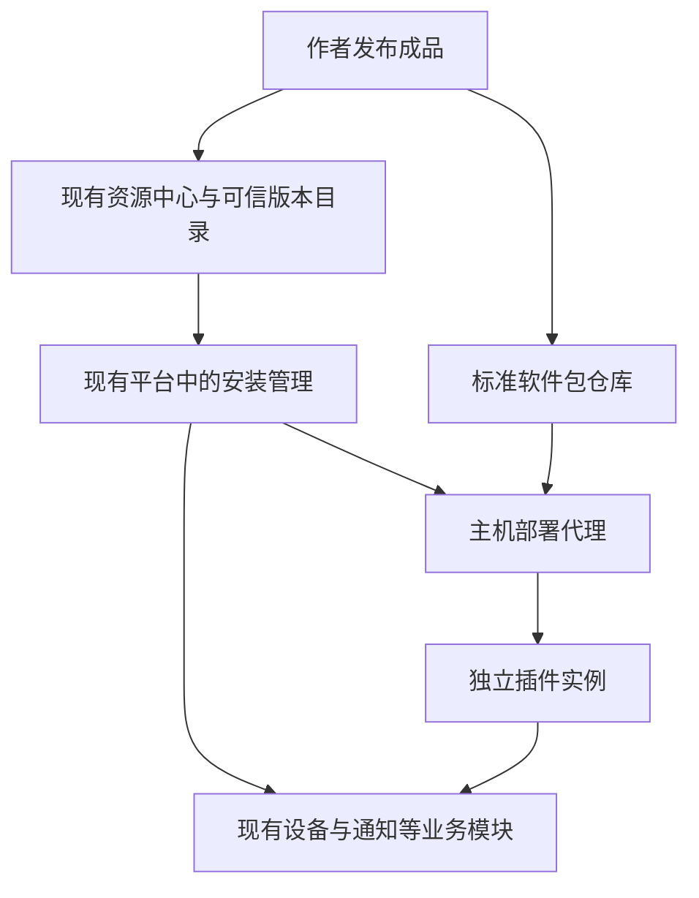
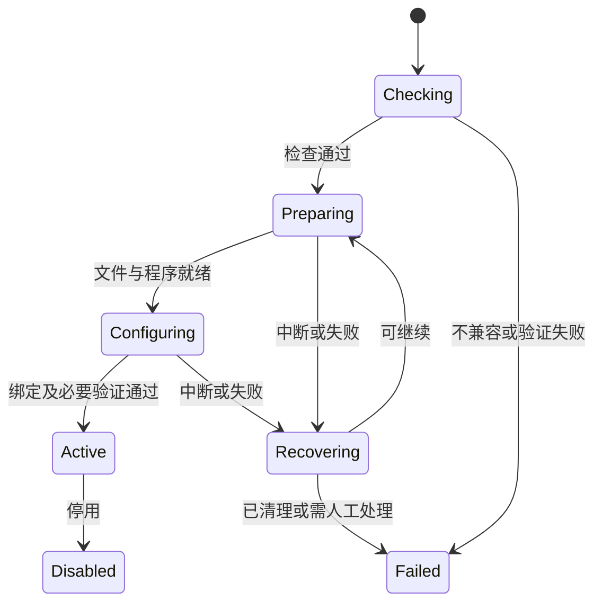

# ThingsPanel 社区版插件发布、下载、一键安装与自动配置设计

**研究日期：2026 年 11 月 1 日（北京时间）**  
**用途：架构决策、产品定义与首期开发拆分**  
**研究基线：ThingsPanel Community v1.3.0；Encore 内核与社区后端并存；现有资源中心继续使用。**

> **建议采用：一个资源中心、一套安装规则、一个受控部署代理，插件独立运行，业务能力接回现有模块。**
>
> 用户选择插件后，系统检查能不能装、取得经过验证的成品、准备运行环境、填写已有配置、接入对应业务，并给出准确状态。系统不知道的账号授权和现场参数，只向有权限的人询问一次。
>
> 本文所说的“最优”，指在现有 ThingsPanel 架构、社区版部署成本、已有插件复用和多租户要求下，综合取舍最合适。它不是未经测试的性能排名，也不是所有场景都适用的绝对结论。

## 阅读指引

- 想判断方向是否正确：看第 1—4 节。
- 想知道按钮按下后发生什么：看第 5—8 节。
- 想评估可靠性：看第 9—12 节。
- 准备安排开发：看第 13—15 节与技术附录。
- 核对论证出处：看文末来源索引；事实附近的编号可以对应到原始资料。

## 1. 先给结论：为什么选这条路线

### 1.1 用户最终得到什么

以安装一个设备接入插件为例，理想体验是：打开 ThingsPanel 的资源中心，选择插件，看到它将增加什么功能、需要什么权限、是否会中断现有连接，然后点击安装。安装后，设备接入页面自动出现新的接入方式；内部服务地址和身份凭据已填好。用户只补充设备地址、串口或厂商账号等现场信息。

以安装通知插件为例，插件自动出现在通知服务目录中。超管选择允许使用的租户，并填写或选择已经配置的服务账号。校验成功后，它成为可选通知渠道。**安装和校验都不发送真实通知；实际发送必须来自明确的业务操作或既有通知策略。**

因此应分别显示三个结果：**程序已安装、配置已完成、业务已启用**。下载成功、容器启动、厂商已受理消息，是不同事实，界面不能混为一谈。

### 1.2 方案的五个核心决定

| 决定 | 用简单的话解释 | 直接收益 |
| --- | --- | --- |
| 扩展现有资源中心 | 继续使用现有“货架”，补充可运行插件的发布资料 | 用户和作者不用迁往第二个市场 |
| 使用统一安装说明 | 每个插件都说明需要什么、怎么配置、怎么判断成功 | 同一个安装器能处理不同业务插件 |
| 默认交付独立容器 | 作者把程序和运行环境一起打包 | 用户服务器不用现场编译，也不必统一所有插件的开发语言 |
| 由受控代理安装 | 只有指定代理能启动、停止插件程序 | 普通插件不会因此获得整台服务器的管理权 |
| 每一步有记录和恢复办法 | 安装中断后查清做到哪里，再继续或撤销本次新增内容 | 减少半安装状态、重复实例和难以恢复的升级 |

这里的容器，可以理解为“带着运行环境的独立程序包”。它能帮助分开运行和限制资源，但不能替代权限检查、软件审核和数据备份。[S32]

### 1.3 为什么不是只做一个下载按钮

从 GitHub 下载源码，只解决“拿到文件”。用户要真正使用，还差版本兼容、服务器架构匹配、启动、凭据、业务登记、租户授权、健康检查、升级和卸载。Docker 也不会替 ThingsPanel 判断一个通知账号是否有效，或者新版是否会破坏旧数据；其官方说明明确区分容器运行与服务就绪。[S33]

**本项目的关键交付，是把这些步骤变成可以重复执行、可以恢复的产品流程。**

## 2. ThingsPanel 现在已经有什么，真正缺什么

### 2.1 公开版本基线与证据边界

截至研究时，GitHub 将 **v1.3.0** 标为最新正式版本，发布日期为 **2026-10-29**，发布提交短标识为 `758abf8`。发布说明写明新增原生物模型及 Encore 自动化服务，社区业务后端继续独立运行。因此，本方案按照 **Encore 与原社区业务模块协作** 来设计，不假设整个平台已经变成单一 Encore 应用。[S01]

资源中心并非空白：官方更新记录显示，v1.2.8 已提供设备模板、大屏模板的浏览、发布、安装、依赖分析和设备重绑，v1.2.9 又完善令牌续期、封面和安装统计。这些链路应直接复用。[S03]

本报告区分四种依据：**正式发布说明、当前公开文档或默认分支、项目共享记忆中的历史线索、本文提出的新设计**。默认分支中的能力不自动等于已发布能力；历史线索也不等于当前代码或生产状态。本次本机代码读取未取得有效结果，没有完成当前本地实现审计，也没有执行生产安装、升级或性能压测。

资源中心公开首页在本次网页检索中未能直接读取，因此不臆测它当前页面的全部功能和私有接口；有关已有模板市场的判断以官方版本记录和公开仓库资料为依据。

### 2.2 插件不能只按“设备、三方、通知”理解

ThingsPanel README 还列出了设备功能模板、设备配置模板、看板卡片、可视化插件和依赖型插件。它们不全是需要常驻运行的程序。[S04]

| 业务能力 | 现有依据与注意点 | 本方案中的安装方式 |
| --- | --- | --- |
| 设备协议接入 | 已有 Device Connector SDK 与设备消息链路 | 部署独立服务，再登记为接入服务 |
| 三方平台接入 | SDK 有云平台设备发现、绑定与同步模式 | 同样部署连接器；另做厂商账号授权 |
| 通知渠道 | 已有独立 HTTP v1 契约及公开适配器 | 部署服务，接入现有通知目录和服务账号 |
| 物模型、设备模板 | 已有模板市场及导入安装 | 校验后调用原有导入接口，不开新容器 |
| 看板、大屏、方案模板 | 已有依赖分析、设备和数据源重绑 | 导入资源并完成绑定；保留来源和版本 |
| 自定义页面、行业应用 | 已有可视化及依赖型扩展概念 | 优先配置式页面；必要时附带独立服务和隔离页面 |
| 北向数据转发、外部动作 | 需与对应版本的连接器、任务和执行契约逐项核对 | 复用业务模块；不把“有接口”直接宣传成“已可市场安装” |
| 报文解码、数据转换函数 | 已有脚本能力，未来可考虑受限执行环境 | 首期沿用已验证能力；以后增加执行方式 |

设备与通知的依据分别来自 SDK 与通知官方说明。[S05][S07] 行业依赖型插件的历史说明仅用于理解扩展类别，不作为当前完整安装机制已经存在的证明。[S11]

**统一的是包装、校验、安装记录和生命周期；设备接入、通知、模型导入仍由各自业务模块负责。**

### 2.3 两个已经查到的兼容性陷阱

**第一，旧文档不能直接当新版本契约。** 设备 SDK 网站示例仍展示旧的设备增删回调和启动同步，而 SDK 仓库 `Unreleased` 说明已经调整为通知触发、连接器自己核对绑定设备，并移除 SDK 负责的部分直接回调。安装器必须核对明确版本或契约摘要，不能看到名字相同就放行。[S05][S06]

**第二，旧可视化发布教程已经标注失效。** 其中把 Vue 组件打包为 JS 并安装的教程明确写着不兼容新版本。不能把它当成现在可直接接着使用的插件商店实现。[S10]

通知插件也不能把“仓库公开”误当“已有可直接下载的成品”。例如 SMTP 仓库当前 Compose 示例是本地构建，并明确不是从仓库拉取已发布镜像。需要补上正式构建、签名、审核和上架流程。[S09]

### 2.4 已有模块的复用线索与核对范围

项目共享记忆提示，系统历史上已有社区后端侧的市场安装编排、Encore 侧的 `pluginmgr` 和独立安装器。这些线索足以要求开发先找原模块，却不足以证明它们当前分别完成了哪些功能。[M02]

因此本方案不预设必须新建“Encore 插件管理中心”。实施时只需先查清三件事：**现在哪个模块保存安装及实例记录；哪个模块登记业务能力；哪个组件能安全启动、停止和恢复主机上的程序。** 现有模块能够承担的职责直接扩展；确实缺少的主机执行能力才补建或改造为 Agent。本文中的职责名称不等于新增服务清单。

## 3. Home Assistant 应该借鉴什么

### 3.1 三种机制各解决不同问题

| Home Assistant 的机制 | 实际作用 | 对 ThingsPanel 的价值 |
| --- | --- | --- |
| Integration，集成 | 在 Home Assistant 内部把设备或服务变成系统可用对象 | 借鉴配置流程、稳定设备身份与能力模型 |
| Apps，旧称 add-ons | 独立程序，由 Supervisor 管理运行 | 最接近设备接入、三方服务和通知插件的部署需求 |
| HACS 社区商店 | 发现、下载和更新社区扩展 | 借鉴 GitHub 来源、目录、版本与更新入口 |

官方说明区分了集成与独立 Apps；Apps 目前要求 Home Assistant OS，HACS 官方也明确自己不管理 Apps。因此不能简单地说“复制 HACS 就能自动部署所有插件”。[S12][S13]

### 3.2 保留经过验证的产品做法

采用一份安装说明、自动生成常见配置表单、自动提供已知连接信息、避免重复设备、在主平台内打开插件页面、统一看日志和更新状态。Home Assistant 的配置文件、配置流程、服务发现和 Ingress 文档分别提供了这些做法的依据。[S14][S15][S17][S43]

ThingsPanel 需要补上的差异是：它面向多租户与设备业务，普通插件不能获得全平台管理员身份；自动发现也不能自动获得控制设备的授权。

### 3.3 截至 2026-11-01 的最新变化

- Home Assistant 在 **2026.2** 已把 add-ons 正式更名为 Apps。[S21]
- HACS 正在整合为 **2026.11 的内置 Marketplace**。检查时正式版仍为 **2026.10.4**，**2026.11.0b2** 是预发布。新文档可以证明演进方向，不能作为已经长期稳定运行的证据。[S19][S20]
- Home Assistant 2026-10-22 更新的安全指南明确表示：构建工具能够签名，但 **Supervisor 当前不检查这些签名**。因此，本方案要求安装时强制验签，是额外补强，不能说是直接继承 HA 现成保障。[S16]

### 3.4 不照搬的边界

Home Assistant 某些插件通过代理访问核心 API 时以管理员身份工作；ThingsPanel 应改成实例、租户和具体能力范围内的授权。[S14] 自定义集成直接进入核心进程的方式，也不适合作为所有第三方设备程序的统一承载方法。

我们要争取“只重启被升级的插件”。但串口独占、设备只允许一个连接、正在执行的通知请求，都可能需要短暂停顿；不能承诺任何插件都无中断升级。

## 4. 多方案比较：为什么这套组合更合适

判断顺序是：**能否复用现有插件 → 能否分别升级 → 能否限制故障与权限 → 用户和团队是否维护得起 → 是否给未来留出扩展。** 以下比较是工程判断，不是虚构的性能评分。

| 路线 | 优点 | 主要代价或缺口 | 结论 |
| --- | --- | --- | --- |
| 下载源码后执行安装脚本 | 起步快，作者自由度高 | 现场编译、脚本权限、依赖差异、恢复办法难统一 | 不作为公开市场安装路径 |
| Go 动态插件或直接加载进内核 | 调用路径短 | 工具链与依赖强绑定，错误更容易影响主进程 | 不作为通用机制 |
| 独立可执行文件 | 不一定需要容器 | 不同系统的依赖、启动和权限处理工作较多 | 可作为受控旧插件兼容方式 |
| 独立容器＋统一管理 | 已有 Go/Python/其他程序容易复用，可单独更新和限制资源 | 需要部署代理、配置、健康检查与恢复流程 | **首期默认路线** |
| 全部改成 WASM | 能严格限定可调用能力，适合小型计算和解析 | 原生库、硬件和已有复杂连接器仍需逐项适配 | 后续用于具体小任务 |
| 全部交给 Kubernetes/Helm | 适合已有集群、跨主机管理 | 社区单机用户运维负担增加，业务配置仍需自己做 | 后续增加执行后端 |

Go 官方直接指出动态插件的工具链和依赖必须匹配等限制。[S25] Grafana 后端插件采用独立子进程与稳定接口，提供了分开运行的成熟参考。[S35] Kubernetes Operator 的持续核对状态方法适合借鉴，但不要求首期引入整个集群。[S34]

分发方面，采用 OCI 通用包格式和 ORAS 等现有工具；它们能承载镜像及非镜像文件，不需要自建一套大文件仓库。资源中心负责展示与批准，现有兼容仓库负责存储和下载。[S26][S28]

安全方面，采用已登记发布者的签名与构建证明，再配合安全更新目录。签名证明来源，不证明业务一定正确；GitHub 官方也明确提醒必须验证证明，不能据此保证程序安全。[S29][S30]

### 4.1 怎样采用先进方案而不增加无谓负担

Helm 4 已将插件“做什么”和“怎么运行”分开，并支持可选 WASM。ThingsPanel 可采用同样的分类原则：通知、接入、转换是业务类型；容器、资源导入、未来 WASM 是运行方式。这样将来增加能力，不需要再造一个市场。[S38]

也必须关注技术退出的信号：Grafana 在 **2026-10-27** 宣布前端 Sandbox 在 13.3 弃用、计划 13.4 删除。本文不猜测其原因，也不把这一预览功能作为长期依赖。复杂第三方页面的隔离方案应独立设计和验证。[S36]

**选择依据明确：独立容器兼容现有插件；统一协议降低作者适配成本；复用业务模块减少改造面；现成分发与验签工具减少自研负担；高级运行方式按需增加。**

## 5. 模块职责：先复用，再补缺口

**本节及后续流程是建议设计。** 名称用于说明职责，不表示必须新增同名微服务、数据库或第二套管理页面。

### 5.1 只保留一条安装主线



图中的资源中心管理可安装的版本，部署代理管理本机程序，业务模块管理设备、账号和权限。插件的日常业务流量不经过公网资源中心。

| 职责 | 应由谁承担 | 明确边界 |
| --- | --- | --- |
| 搜索、发布者、商品与版本展示 | 现有资源中心及市场服务 | 不直接控制用户服务器 |
| 安装计划、依赖、进度、版本和归属记录 | 优先扩展现有市场安装编排或插件管理模块 | 只管理交付，不复制设备、通知或租户业务 |
| 拉包、验包、启动停止、资源和网络限制 | 一个独立部署代理，以下简称 Agent | 只接受规定的操作，不提供任意命令入口 |
| 设备注册、模型导入、通知账号、策略、规则 | 原有业务模块，通过原有受控接口调用 | 安装器不直接改其他模块的数据库 |
| 具体协议、云平台、服务商适配 | 插件自己的进程 | 不取得主库账号或平台管理员身份 |
| 日志、权限、审计、密钥保存 | 复用现有平台能力并补齐缺项 | 不各建一套通用基础设施 |

**安装管理放在当前承担安装职责的模块中。** 如果市场安装仍由社区后端负责，就在那里扩展；如果某部分已由 Encore 的插件管理接管，就沿其接口补齐。不要仅因“内核用了 Encore”，再创建第二套安装登记与任务系统。

Agent 必须是独立权限边界，因为管理容器的接口权限很高；它不适合直接交给面向用户的业务服务，更不能挂载到每个插件中。Docker 官方对这一权限风险有明确说明。[S32]

### 5.2 Encore 的正确位置

Encore 从源码静态分析服务和资源，并在构建时形成应用模型。因此，**运行时安装第三方插件，应调用已经存在的扩展接口；不能假设 Encore 会自动把下载的新代码变成一个原生服务。** 第一次补充安装管理 API 需要正常发布主平台；之后安装兼容插件不应反复重编译内核。[S22]

Encore 的自托管镜像也不自动执行数据库迁移或触发定时任务。这些工作必须沿 ThingsPanel 已有安装器和调度模块落实。安装恢复循环不能依赖一个没有实际配置的定时触发器。[S23]

固定边界如下：

- 设备消息沿现有 ThingsPanel 通道传输，不为了商店重新引入一套消息总线。
- 通知调度、投递记录和业务重试仍归通知核心。
- 模型、设备和规则变更通过各自业务接口完成。
- 内部服务间认证与插件实例授权分开。Encore 的私有接口在未配置认证方法时并不自动要求认证；应同时限制网络与调用身份。[S24]

### 5.3 把“装了哪种插件”和“给谁使用”分开

建议明确四个对象，优先映射到已有数据结构：

| 对象 | 例子 | 保存内容 |
| --- | --- | --- |
| 插件身份 | 某发布者的 SMTP 插件 | 固定 ID、发布者身份、支持的能力 |
| 发布版本 | 该插件 1.2.0 | 包的指纹、兼容条件、权限、配置格式、审核状态 |
| 部署实例 | 某主机上运行的 SMTP 服务 | 主机、实际运行版本、健康状态、实例身份 |
| 业务绑定 | 租户甲使用账号 A；租户乙使用账号 B | 原业务模块中的账号、设备、项目和权限引用 |

一个程序包可以只下载一次，但租户的业务配置和授权不能因此混在一起。首期第三方连接器优先按租户或服务账号隔离实例；共享服务必须经过专门的多租户验证，且每个请求都由现有业务入口核对授权。不能仅凭插件提交的 `tenant_id` 信任它。

当前通知管理文档规定由超管维护服务商账号和密钥，租户使用已分配服务。本设计保留该规则，不把“一键配置”变成租户自动获得管理密钥的权限。[S42]

## 6. 插件怎么发布：交付能安装的成品

### 6.1 三种包，共用一份发布规范

1. **资源包**：模型、设备模板、看板、方案配置等；通过原有导入器安装。
2. **服务包**：设备接入、三方连接、通知等；运行一个或多个明确声明的服务。
3. **组合包**：锁定上述包的具体版本，并声明它们之间的绑定，例如“协议服务＋设备模型＋看板”。组合包不再运行另一个安装器。

不是所有文件都是无害资源。包含脚本、表达式或网页代码的包，必须声明执行能力并按代码权限审核；不能换一个“模板”名称绕过限制。

### 6.2 安装说明必须回答的问题

| 内容 | 必须回答的具体问题 |
| --- | --- |
| 身份 | 谁发布？固定插件 ID 是什么？源码和问题反馈在哪里？ |
| 内容 | 下载哪一个确定的包？包含哪些资源和运行镜像？ |
| 兼容 | 支持哪些平台版本、业务接口版本、CPU 和运行环境？ |
| 权限 | 要读哪些设备？能否发命令？要访问哪些外部地址、端口或硬件？ |
| 配置 | 哪些由平台生成？哪些从已有账号选择？哪些必须用户填写？ |
| 业务接入 | 登记到哪个现有业务模块？调用哪一版契约？ |
| 运行 | 如何判断程序存活、准备完成和业务可用？ |
| 数据 | 写哪些专用目录？数据格式版本是什么？能否回退？ |
| 升级与卸载 | 是否独占硬件？如何停止接收任务？哪些数据默认保留？ |
| 依赖与许可 | 依赖哪些准确版本？许可证、维护者和支持范围是什么？ |

安装说明只描述**受支持的动作**，不允许作者附带“在宿主机执行任意脚本”。业务配置 schema 沿用对应插件契约；安装包引用其文件和指纹，避免在两处分别维护同一份表单。

通知契约使用 JSON Schema Draft 2020-12，但后台可校验的字段范围大于当前网页表单可编辑范围。上架检查需要同时验证后台校验和界面显示，不能只验证 JSON 合法。[S07]

### 6.3 作者到上架的完整流程

1. 作者用现有设备或通知 SDK 实现业务；其他语言只要符合固定接口，也可以参与。
2. 在开发环境完成测试，明确需要的权限、配置和恢复方式。
3. 构建固定源码提交对应的成品，输出支持的 CPU 架构，固定构建工具和依赖。
4. 自动检查接口、配置表单、文件路径、依赖循环、漏洞与许可证；执行安装、停止和升级恢复测试。
5. 生成包指纹、依赖清单和构建来源证明；签署包含安装说明及所有附件指纹的发布单元。
6. 上传到兼容的镜像／软件包仓库；GitHub Release 保存版本说明及下载入口。
7. 资源中心验证发布身份和测试结果，批准指定指纹，放入稳定版或测试版目录。

只签镜像而不保护安装说明不够：攻击者仍可能更改权限、下载地址或启动参数。审核对象必须是**完整发布单元**。

### 6.4 GitHub、国内镜像与离线安装

**GitHub 是一个发布来源，任意 GitHub 仓库不是安装包。** “添加来源”应解析符合 ThingsPanel 规范的发行版；源码仓库没有成品时，明确显示“尚无可安装版本”，不在客户机器执行 `git clone` 后的未知安装命令。

镜像地址可以改变，包内容必须不变。主源、国内镜像和私有仓库下载后都核对同一指纹；镜像同步应连同签名和审核资料一起保留。用户不用了解这些细节，只看到下载成功或准确的失败原因。

多架构包记录总目录指纹和实际 CPU 对应的子镜像指纹；版本标签只用于展示。Docker 标签可以变，指纹对应固定内容，这是可复现安装和恢复的基础。[S27][S28]

离线包需要包含**全部锁定依赖、运行镜像、资源、签名、构建证明、可信目录快照与必要的信任根更新链**。缺一个依赖就停止，不能偷偷改装别的版本。新信任根必须由已信任的根或管理员明确建立的信任关系验证，不能直接信任包里自带的任意公钥。

离线验证只能核对已获得的证据，不能知道断网后新发生的撤销；界面必须显示安全目录更新时间。过期时要求导入更新资料，或走预先定义且记录在案的离线例外流程，不能自动关闭验签。[S39]

## 7. 点一下安装，系统具体做哪些事

### 7.1 两个入口，进入同一个安装流程

- **平台内入口**：用户在 ThingsPanel 的资源中心选择插件，平台已知道当前目标实例与登录身份。
- **公网资源中心或 GitHub 入口**：链接只携带插件 ID 和固定版本，跳转到用户自己的 ThingsPanel；由目标平台登录、检查权限并生成安装计划。

公网网页不能直接控制内网服务器。第一次可以让用户选择自己的平台地址；无法跳转的隔离网络提供“复制安装引用／导入离线包”。链接不携带管理员密码，也不能通过访问一个 GET 地址就执行安装。

### 7.2 一次性环境准备

全新安装器应一起配置运行环境和 Agent，建立平台与主机之间的认证。已有部署需要先完成一次受控接入：确认安装目标、Agent 身份、允许操作的目录和资源、版本兼容及证书轮换。此后安装普通插件才是真正的一键。

没有 Agent 的环境，继续允许管理员登记一个已手动部署的插件地址；界面标成“外部管理”，不显示无法兑现的自动升级与卸载按钮。首期建议正式支持 Linux 的 amd64、arm64 容器主机；其他宿主环境要经过实测后加入支持表。

### 7.3 从点击到可用的九步

| 步骤 | 系统自动完成 | 不满足时的明确结果 |
| --- | --- | --- |
| 1. 确认安装计划 | 核对操作者、目标主机、租户范围、权限变化与依赖 | 无权安装时停止；需要现场信息时只列缺项 |
| 2. 检查兼容 | 核对平台、业务协议、CPU、磁盘、内存、端口、硬件和 Agent 能力 | 显示具体不兼容项，不先装再碰运气 |
| 3. 固定完整版本 | 解析依赖并生成锁定清单，发现循环或冲突即拒绝 | 不擅自升级内核或修改正在使用的共享依赖 |
| 4. 下载并验证 | 按指纹下载，校验来源、签名、目录有效性与安全撤回状态 | 未验证完成的内容不能运行 |
| 5. 准备运行条件 | 创建专用身份、目录、网络、资源限制和内部地址 | 只清理本次创建且未被使用的资源 |
| 6. 启动待配置实例 | 启动后做进程、协议和只读检查，暂不接收真实任务 | 显示“已安装，待配置”或具体错误 |
| 7. 建立业务绑定 | 调用原业务接口导入模板、登记服务、选择已有账号及设备 | 每个接口带稳定操作号，失败后可查询和继续 |
| 8. 启用与观察 | 必需检查通过后开放对应能力；按声明的策略观察运行 | 不合格时恢复原绑定或保持待配置 |
| 9. 展示使用入口 | 在设备、通知、规则或看板中显示实际能力及状态 | 不用用户手工复制地址、改配置文件或重启主平台 |

安装前应把权限和影响说清楚，例如：“将安装一个邮件服务；由超管选择可用租户；可连接指定邮件服务器；不读取设备遥测；安装过程不发送邮件。”已有授权、配置齐全、没有新增风险权限时，一个安装按钮即可完成后续步骤。

### 7.4 系统自动填什么，用户必须提供什么

| 信息 | 处理方式 |
| --- | --- |
| 平台内部地址、插件实例 ID、回调地址、健康检查地址 | 自动生成和填写 |
| 插件到平台的独立身份、允许的设备消息权限 | 自动发放，可撤销；必须有底层实际支持 |
| 已授权且兼容的账号、模型、模板 | 唯一且已明确绑定当前租户／项目时自动复用；有多个候选时让用户选择一次，之后保存绑定 |
| 第三方平台同意授权、验证码、账号密码 | 由有权人员完成；不能自动猜测或绕过 |
| 串口、设备 IP、站号、寄存器含义、项目归属 | 自动发现能确定的部分；其余让用户补齐 |
| 对真实设备下发命令、发送短信邮件、开启新的收费调用 | 由明确业务选择或既有授权策略触发 |

如果现有 MQTT 服务不能发放和撤销足够细的凭据，应该走核心受控转发接口或先补齐权限能力，不能退回“所有插件共用一个管理员账号”。

### 7.5 待配置不等于可以任意访问外部

只在数据库写一个 `inactive` 标志还不够，插件启动后仍可能自行连设备或调用厂商。应同时暂停真实任务投递、设备控制绑定和业务写入权限，协议支持待激活状态；只开放经过限定的检查。

对于读写混用的厂商密钥，不能声称“不下发写权限”就绝对阻止写操作。应使用经过审核的只读校验流程、必要时由核心代校验，并把第三方代码取得该密钥后的实际能力纳入授权说明。不支持待激活模式的旧插件，走维护窗口和明确的兼容流程。

## 8. 三个具体使用场景

### 8.1 安装 Modbus 接入及配套看板

管理员选择一个组合包。平台安装指定版本的接入服务，并导入相应模型与看板模板。平台自动提供消息连接信息和实例身份；管理员选择接入主机，填写设备地址、站号或串口，选择实际设备及模板。

系统先尝试只读采集，在界面展示一条经过解码的样本数据，再把设备和看板绑定。**寄存器含义不明时不能自动猜测；没有数据也不能直接判定程序损坏，应区分设备未连接、配置错误与插件异常。** 写寄存器、启停设备等动作不用于安装健康检查。

如果串口已被另一实例占用，安装应停在检查阶段，并告诉用户被哪个实例使用，不能强行抢占。升级这类插件采用停止旧连接、交接、启动新实例的流程，并显示预计中断窗口。

### 8.2 安装三方云平台连接器

系统部署连接器、登记接入能力并打开配置表单。有权人员选择已有账号，或完成厂商授权；平台读取允许查看的设备列表，让用户确认项目与设备范围。已绑定设备按稳定外部 ID 对账，重复安装或重新授权不重复创建设备。

OAuth 回调、令牌刷新和失效后的重新授权使用现有账号管理流程。厂商限制调用频率时，连接器遵守限速；错误状态显示“厂商限流，正在等待”，不能无限重试，更不能把这一状态误报成“安装失败”。

### 8.3 安装 SMTP 通知插件

安装器拉取固定成品，注入实例鉴权所需配置，登记已有通知 HTTP v1 接口。超管为指定租户配置或选择服务账号，按原通知模块规则保管密钥；安装记录只保存账号引用，不复制一套服务商密码库。

校验阶段允许有时限的只读检查，不发送消息。系统邮件与租户告警邮件分别绑定各自用途，避免只配置一种却误认为两种都完成。明确选择测试目标和内容后，才进行测试发送。[S07][S42]

结果必须如实显示：服务商受理是 `accepted`；能证明未受理才是 `rejected`；已提交但响应丢失是 `unknown`。最后一种不能当作普通失败自动重发，安装器也不能另起一套通知重试逻辑。[S08][S09]

## 9. 可靠性：每类故障都有处理结果

### 9.1 安装不是一段长命令，而是一份能恢复的工作记录

推荐把安装目标、固定版本、已完成步骤、资源归属和最后错误写入现有数据库。后台工作循环不断比较“应该是什么”与“实际是什么”；进程重启后从记录恢复。Kubernetes 的控制器模式提供了成熟参考；首期可以在现有服务内实现，无需增加一个 Kubernetes 集群，实际恢复效果仍须故障测试证明。[S34]

操作至少记录：操作 ID、插件发布指纹、实例 ID、目标主机、授权范围、配置版本、步骤状态、资源 ID、执行代次、失败原因。凭据正文不进入操作日志。

**同一次请求重试只产生一次结果。** 用户双击、页面断线、代理重新领取任务，都应查到同一操作及对应资源。真正要安装第二个独立实例，必须创建新的实例身份，而不是靠换一个随机重试 ID 绕过重复检查。



上图表示安装过程；运行健康另外记录为“正常、降级、异常”。安装完成后厂商临时断网，不应把整个历史安装任务改写为失败。

### 9.2 跨 Encore 和社区后端的恢复办法

不能把部署容器、登记设备服务和创建通知账号假设成一个数据库事务。各步骤通过对应业务 API 执行，并携带同一个可查询的操作标识。

例如：设备服务已经登记成功，返回途中断线。安装管理恢复后先查询这条记录是否存在、是否属于本次操作，再补记完成；不能直接再新增一条。各业务模块对“准备、查询、启用、撤销”提供最小必要能力，沿已有模块扩展，不另建通用业务中心。

组合包也不承诺跨系统的瞬时原子操作。应先准备全部资源，最后开放用户可见的业务绑定。中途失败，只撤销本次新建且没有其他使用者的内容；用户原有账号、设备、模板和后续人工修改默认保留。

### 9.3 具体故障与可见结果

| 故障 | 系统行为 | 用户看到什么 |
| --- | --- | --- |
| 下载到一半断网 | 保留合法缓存，恢复时继续取得同一指纹；支持的仓库可续传 | “下载中断，可重试；尚未启用” |
| 镜像标签被替换 | 仍按锁定指纹取得成品；不一致即拒绝 | “下载内容与发布记录不符” |
| 主机 CPU 不支持 | 启动前拒绝 | “该版本没有适合这台主机的安装包” |
| 容器存在，但平台未完成登记 | 根据实例标签和操作号核对后继续 | 显示真实进行到的步骤 |
| 业务已登记，返回响应丢失 | 查询已有记录，不重复创建 | 安装继续，无重复接入服务 |
| 配置缺少授权 | 保持待配置，不接受真实业务任务 | “需要厂商授权”及直接入口 |
| 插件反复退出 | 限次退避重启，超过阈值停在异常；保留脱敏日志 | “启动失败，查看原因／恢复旧版” |
| 资源中心不可达 | 已安装插件继续使用本地配置；暂停无法验证的新安装 | “市场暂不可用，现有服务继续运行” |
| Agent 不在线 | 新任务保持等待；不能把旧实例强行视为已停止 | “目标主机离线，未切换版本” |
| 两人同时升级同一实例 | 只允许一个有效执行代次，过期结果不能覆盖新状态 | 后来的操作显示已有任务 |
| 原插件被用户手工移动或改过配置 | 标记偏差，先核对所有权；不删除陌生容器或覆盖人工数据 | “检测到外部修改，需要选择处理方式” |

### 9.4 超时、重试和并发的具体规则

安装器只自动重试**可证明重复执行不会增加副作用的步骤**：按指纹下载、查询状态、确保某个专用目录存在等。创建资源必须有唯一键或可查询的操作号。已向第三方提交的通知、设备命令等业务动作不由安装器重试。

安装计划绑定主机、实例和执行代次。Agent 在实例锁内持久记录已经接受的最高代次；每次改变容器、路由或权限前再次核对，过期任务拒绝执行，而不只是拒绝其结果回写。主机上为同一实例保留本地互斥锁，避免平台多副本或网络抖动导致双重操作。

不同实例之间也可能争抢同一串口、固定端口或主机容量。检查通过后，应按主机原子预留独占资源与预算，启动前再检查实际占用；失败只释放本次可安全释放的预留。端口按监听地址、协议和端口组合识别，硬件使用稳定身份。主机失联或任务超时不等于资源已经释放，核实后才能转交。若用户在平台外另起程序占用了端口，明确报冲突，不杀掉陌生进程。

任务状态和待处理记录应在同一持久化事务中保存，启动后补扫未完成任务。优先复用已有队列或任务设施；没有必要仅为安装再引入一套消息中间件。

## 10. 升级、回退与卸载

### 10.1 每次升级先回答三个问题

1. 新程序能否读现有数据和配置？
2. 旧程序能否读升级后的数据？
3. 两个版本能否同时接设备、消费消息或调用厂商？

不能明确回答，就不能把自动回退标成可用。Docker 数据卷独立于容器生命周期，更换镜像并不会自动恢复旧数据。[S40]

### 10.2 按插件特点选择升级方法

| 插件特点 | 升级方法 | 失败后的处理 |
| --- | --- | --- |
| 无独占连接、无不兼容数据变更 | 新版本先在待激活状态检查，再切换业务入口 | 切回旧入口，保留原实例 |
| 串口、固定端口、设备只允许一个连接 | 暂停任务，确认旧实例退出，再启动新版本 | 确认新实例退出后恢复旧实例 |
| 数据格式兼容，但配置需要变化 | 先生成配置副本并校验，保留上一版本 | 恢复旧配置及原绑定 |
| 数据格式不向后兼容 | 停止写入，取得一致备份，运行受限迁移，再检查 | 恢复插件自己的数据和配置；说明停机及可能损失窗口 |
| 无法证明恢复正确 | 阻止无人值守升级 | 提供人工迁移方案与维护窗口 |

需要保存的恢复单元是：**原程序指纹＋配置版本＋插件数据备份＋业务绑定清单**。不能只保存旧镜像。

### 10.3 双实例并行必须防止重复副作用

数据库里把旧实例的租约标为失效，不一定阻止它继续用已经拿到的厂商密钥发消息。真正切换时必须暂停投递、处理在途任务、撤销可撤销的访问权，并确认旧进程已退出或其网络访问已被有效切断。

如果旧主机失联而无法确认隔离，就不自动在另一主机启动具有写操作的替代实例。采集服务是否允许重复连接也由协议具体决定，不能统一套用网页服务的并行切换办法。

通知切换要保留投递账本与不确定结果，不能恢复旧快照后把已受理通知重新发一遍。设备控制命令同样不能靠“回滚版本”撤销已经发生的物理动作。

### 10.4 默认更新策略

默认提示可更新，由管理员选择维护窗口。只有兼容性、权限和恢复检查通过的版本，才允许进入用户事先启用的自动更新策略。

以下情况必须重新展示影响：新增网络或设备控制权限、更换发布者身份、需要升级内核、更改数据格式、独占硬件交接、插件申请跨租户共享。不能因为版本号只改了最后一位，就自动认定安全。

### 10.5 卸载应该保留什么

卸载前列出依赖它的设备、通知策略、看板和其他包。先停用新任务，解除或迁移业务绑定，撤销实例身份，再删除属于该实例的运行资源。

默认保留业务数据和用户配置；需要彻底清除时单独列出删除清单。被别的方案引用的共享依赖不删除；卸载模板不自动删用户实际设备或历史遥测。日志和操作记录按平台现有保留规则处理。

## 11. 安全与市场治理，落实到具体控制点

### 11.1 四道检查，各自解决一个问题

| 检查 | 解决的问题 | 不能替代什么 |
| --- | --- | --- |
| 内容指纹 | 下载内容是否被换过 | 不能证明作者可信 |
| 发布身份及构建证明 | 是否来自登记的仓库和构建流程 | 不能保证代码没有漏洞 |
| 审核与兼容测试 | 是否符合平台接口、权限和质量要求 | 不能保证永远不出错 |
| 运行时权限与资源限制 | 出错或作恶时能影响多少范围 | 不能保证没有宿主或运行时漏洞 |

签名验证必须绑定预期发布者、仓库、工作流与身份签发方，不能“任何有效签名都通过”。完整发布包和实际运行镜像的内容关系也必须验证。[S29][S30]

### 11.2 防止被推送旧目录或错误更新

公开市场上线前采用成熟的安全更新目录机制，例如 TUF 及其现成客户端。它验证目录版本、有效期、完整性和信任根更换，减少旧目录重放、长期冻结或元数据混搭的问题，不自行发明一套签名协议。[S31][S41]

平台安装包内置初始信任根，根权限与日常发布权限分开。发布撤回后保留历史记录，阻止新增安装。回退到已知旧版是经过授权的恢复动作，须保留当前有效目录并检查目标未被禁止；不能为回退而关闭防版本倒退校验。

目录失效不意味着已经运行的设备服务立即停机。发现严重风险时，按事先配置的策略通知、阻止新任务、撤销敏感权限或隔离实例；远端市场的一次状态变化不应无条件重启整个平台。

### 11.3 Agent 的实际权限边界

- 插件不获得 Docker 管理接口；Agent 自身不提供任意 shell、任意宿主路径或任意 Compose 参数。
- 默认非 root、只读程序目录、专用数据卷，并限制 CPU、内存、进程数和日志大小。磁盘预算与硬配额分开：只有主机存储支持且实际启用配额，才能宣称硬限制；否则明确显示容量检查和监测，不能满足硬隔离要求时拒绝该部署档位。Docker 官方对特定存储配额列有文件系统和挂载条件，它不是任意数据卷天然具有的能力。[S44]
- 只挂载批准的设备与目录，不挂载宿主根目录、主库目录或其他租户数据。
- 平台到 Agent 使用明确主机身份、短期任务授权与防重放校验；主机断线后可恢复，证书可轮换。
- Agent 再次检查包、主机能力和允许动作，即使上游传入计划也不能直接照单执行。
- 插件迁移程序只能在受限容器内访问自己的数据，不执行宿主机迁移脚本。

外连白名单必须有执行机制。Docker 独立网络本身不等于域名白名单：HTTP 调用可走受控代理，设备 TCP/UDP 可由主机网络规则限制到批准的地址和端口。声明了某种限制但当前主机不能执行时，应拒绝相应受限安装，或让管理员选择明确标注限制不足的专用环境，不能显示“已隔离”。

容器共享宿主内核。要求更强隔离的客户应使用独立主机或经过验证的额外隔离环境；这属于可选部署档位，不强加给首期所有社区用户。[S32]

### 11.4 前端扩展也必须受约束

普通设置页面优先由平台根据表单定义渲染；看板资源使用既有导入与渲染能力。需要第三方网页代码时，使用独立来源的受限 iframe，通过少量、明确的消息接口交换数据，并验证来源、消息格式和权限。

不把不受信任的 JS 直接加载到主界面并给予其主页面会话。隔离页面不读取平台管理员 cookie，使用限时、限定实例与用途的访问方式。若当前安装环境无法提供所需隔离来源，首期仅支持配置式页面，暂不开放该类网页扩展。

### 11.5 市场标识应说明验证范围

至少区分“官方维护”“通过兼容测试”“社区发布”“停更／安全撤回”。“通过兼容测试”应显示测试的平台版本、架构、日期和范围，不包装成绝对安全。

发布者转让、仓库迁移、维护者失联和密钥轮换都有处理规则。平台保留已安装版本及恢复所需成品，不能因为作者删仓库就立刻失去恢复能力。下载统计和安装诊断不得携带客户设备数据、服务商凭据或通知正文。

## 12. 怎样证明它可靠：上线前的验收清单

下表是**必须执行的验收设计，不是本次研究已经跑过的测试结果**。可靠性结论应由这些结果支撑，不能只靠架构图。

| 测试 | 必须出现的结果 |
| --- | --- |
| 同一安装请求连续及并发重放 100 次 | 只有一个目标实例、一份对应绑定；每次返回同一操作结果 |
| 在下载、创建、登记、启用前后分别杀掉管理进程或 Agent | 恢复后能继续或准确清理；不丢操作记录，不出现无归属资源 |
| 业务登记已成功但故意丢掉响应 | 查询后识别已有记录，不重复创建服务、设备或账号 |
| 修改发布包、权限说明、镜像，或换成其他发布者的有效签名 | 全部在运行前拒绝 |
| 用旧目录、过期目录或不匹配的更新资料 | 拒绝新增安装；已安装业务按离线策略继续 |
| 缺少 CPU 架构、磁盘不足、端口或串口被占用 | 启动前说明原因，现有实例不受影响 |
| 插件启动但尚未激活 | 不出现真实通知、控制命令或未经允许的外部写操作 |
| 插件能响应健康检查，但厂商账号无效 | 显示需要配置或账号错误，不显示业务可用 |
| 租户甲访问租户乙的实例、凭据、日志、设备消息 | 在业务入口和必要的消息权限处拒绝 |
| 受限插件访问未批准地址、宿主目录或 Docker 接口 | 执行层确实阻断；不能仅在 UI 声称禁止 |
| 新版本健康检查失败 | 原绑定仍有效，或按选定维护方案恢复原版本 |
| 新旧版本数据不兼容 | 必须先有可恢复备份；不能把更换镜像报告成回滚完成 |
| 旧实例失联但可能仍在发送 | 不自动启用另一个写实例；保持待处理状态 |
| 旧任务排队，较新任务已经完成 | Agent 在执行前拒绝旧代次，不改动容器、路由或权限 |
| 两个不同实例同时申请同一串口或端口 | 只有一个预留成功；另一个收到明确冲突结果 |
| 通知提交后模拟响应丢失 | 记录不确定结果，不产生安装器触发的重复发送 |
| 主平台、主机及 Agent 分别重启 | 指纹、配置、身份和业务绑定一致；插件能按策略恢复 |
| 资源中心离线一整天 | 已安装插件不因市场断网而停用；新安装准确显示受限原因 |
| 卸载被其他方案引用的插件 | 阻止误删依赖，列出实际受影响对象 |
| 两个账号、不同租户、多个同类实例 | 凭据和状态独立，去重不会误合并合法实例 |
| 离线包缺依赖、缺信任链或安全目录过期 | 明确阻止或进入已定义的人工例外流程，不静默降级 |
| 模板被用户修改后升级或卸载 | 展示差异，保留用户修改和实际设备，追踪资源归属 |

另做三组真实使用验证：一个设备接入、一个三方云连接、一个通知适配器。先使用模拟设备／服务商验证失败场景；真实设备和真实发送另行在授权测试环境验收。界面测试需要覆盖动态菜单、权限、配置表单和实际使用入口，路由存在不等于用户已经能看到菜单。

性能验收要记录目标硬件、插件数量、消息量、冷下载与缓存安装时间、重启时间、内存峰值和额外调用耗时。本次没有这些实测数据，因此不给“安装一定几秒完成”或“零性能损耗”的承诺。

## 13. 旧插件和旧版本怎样迁移

### 13.1 对现有插件分批纳管

| 现状 | 处理方式 | 不做的隐含假设 |
| --- | --- | --- |
| 已有可运行的设备／云连接器 | 固定接口版本，补安装说明、正式镜像和健康检查 | 不要求重写业务语言或迁入 Encore |
| 已有通知 HTTP v1 插件 | 保留契约，补成品发布、部署登记和账号选择流程 | 不新建通知队列与业务重试 |
| 已有手动部署实例 | 识别为外部管理；经过显式接管检查后再由 Agent 管理 | 不自动删除未知容器或更换现有凭据 |
| 已有模板与看板包 | 沿原导入器，补来源、版本、文件指纹和资源归属 | 不把已有设备当新资源重复创建 |
| SDK 接口仍在变化 | 固定发布标签或提交及契约摘要，建立兼容清单 | 不把 `main` 或 `latest` 当稳定接口 |
| 依赖旧内核内部对象或直连主库 | 暂时使用受控适配；先建立必要业务接口再开放市场 | 不给第三方发主库权限作为快捷方案 |

模板迁移要保留物模型和设备引用关系，区分“发布包内的逻辑 ID”与“安装后平台生成的 ID”。重新安装按来源及实例对账；已有资源发生冲突时，明确选择复用、复制或停止，不能无提示覆盖。

现有脚本或旧插件若缺少安全停止、待激活或数据恢复能力，仍可保留兼容登记，但不能获得“自动无中断升级”标识。

### 13.2 现有产品演进顺序必须保留

插件市场建设不应改变已经确定的内核迁移顺序。先完成社区版物模型与 Encore 的既有整合、兼容 ID 和运行时引用验证，再在这条基线上扩展交付机制。通知可以作为安装流程的验证样例，但不因此取代原来的物模型优先事项。

这一点来自本次查回的项目共享记忆；它是既有项目约束，具体完成状态仍须按当前代码和验收结果判断，不能因为记忆里出现过“已合入”就认定已发布或部署完成。[M01]

## 14. 推荐实施顺序与交付范围

### 第 0 阶段：确定现有模块归属与版本边界

交付一张现有模块责任表、一套业务契约锁定清单，以及当前社区版、Encore、安装器、前端的对应版本。核对现有插件管理、市场安装记录、服务实例、租户授权和资源导入是否已有实现。

**完成标准：** 开发者能够回答“这条记录谁维护、失败由谁恢复、调用哪个接口”。这一步没做清楚，后续最容易重复建模块。

### 第 1 阶段：打通一个真实的组合安装

优先沿物模型和资源包链路，选择一个成熟设备连接器，完成“版本成品＋部署＋模型导入＋设备绑定＋使用入口”。补充 Agent、持久操作、指纹锁定、最小权限、只读校验和失败恢复。通知无发送模板可并行验证业务契约接线，但不改动既定迁移优先级。

**完成标准：** 对一个完整案例，无需登录服务器改配置；重复点击和中断恢复通过；失败能说明原因；原有业务不被误改。

### 第 2 阶段：公开市场的可运营版本

开放作者提交与审核，加入发布身份校验、安全更新目录、测试与稳定渠道、国内镜像、离线包、依赖冲突处理、更新及卸载。完成设备、三方、通知三类样例，以及前端菜单和权限的端到端验收。

**完成标准：** 第三方作者按规范能独立发布；用户能安装、配置、升级和恢复；第 12 节关键故障测试通过。此时才对外承诺“市场一键安装”。

### 第 3 阶段：按实际需求增加能力

扩大组合方案、隔离网页应用、更多厂商插件；对已有明确收益的解析／转换场景增加 WASM；对有集群需求的客户增加 Kubernetes 执行后端。沿用同一包规范、权限和安装记录。

首期无需自建镜像仓库程序、通用脚本平台、另一套消息总线、独立密钥产品或新的规则引擎。需要的是把现有能力连完整，并证明恢复路径有效。

### 投入如何评估

在完成第 0 阶段前，不宜承诺固定开发周数：主要工作量取决于现有安装器是否可复用、业务接口能否幂等登记、Agent 是否已有、模板数据映射是否完整，而不是安装按钮有多复杂。

建议按四个可验收工作包估算：**发布与校验、主机执行与恢复、业务自动接线、前端及端到端测试**。每个工作包明确负责人，但不必对应四个新服务。先用第 1 阶段的实际改造量估算第 2 阶段，避免在未审清旧模块前给出虚假的精确工期。

## 15. 用最简单的话解释：为什么可靠，为什么值得选

**可靠性来自可检查的步骤和明确的恢复规则。** 装之前确认版本、来源、权限和环境；装的时候每一步记账；装完检查能否按业务接口工作；升级前确认数据能否恢复。每一类失败都有明确的停止、继续或恢复条件。

**适合 ThingsPanel，是因为它能复用已有能力。** 平台已经有接入 SDK、通知契约、模板市场和 Encore 服务。把这些现有能力接进统一交付流程，比要求所有插件重写、所有用户先运维集群，更符合当前目标。新增加的安装职责集中在现有控制模块和受控 Agent 中，设备、通知、权限各守原来的职责。

**长期扩展空间来自业务用途和运行方式分开。** 今后增加一个厂商、一种协议，通常只需要发布一个遵守现有接口的新包；确实出现新的业务能力时，先为内核增加稳定扩展接口。容器、资源包或未来 WASM 都沿用同一市场与版本记录。

**条件改变时，执行方式也应该调整。** 如果主要客户已经统一使用大型集群，执行层应优先适配 Kubernetes；如果绝大多数插件只是小型纯计算函数，应提高 WASM 的优先级；如果硬件必须使用专有驱动，则需要单独验证主机兼容方案。这些变化影响执行方式，不需要推翻市场和业务接口的分工。

**最终要交付的可验证承诺是：用户不需要处理系统已经知道的配置；系统不会把未经验证的包运行起来；安装中断不会无记录地留下一半；不能安全恢复的升级会在开始前说明。**

## 技术附录 A：建议的安装说明示例

以下是**待制定的新安装包规范草案**，不是当前 ThingsPanel 已支持的配置文件。版本、仓库、资源值均为示例，不能直接拿去部署。现有通知业务 manifest 保持原契约；这里只引用它，不重新定义一套通知能力。

```yaml
apiVersion: thingspanel.io/package/v1
id: example.notification.smtp
version: 1.0.0
name: SMTP 邮件服务
category: notification
packageType: service

publisher:
  id: example
  source: https://github.com/example/smtp-plugin

compatibility:
  # 示例范围，必须改成实际测试通过的平台范围
  platform: ">=1.3.0 <1.4.0"
  agentApi: "1"
  contracts:
    notificationHttp: "1.0"
  platforms: [linux/amd64, linux/arm64]

runtime:
  type: container
  # 必须替换为已签名的真实多架构镜像指纹
  image: "registry.example.com/example/smtp@sha256:REPLACE_WITH_64_HEX"
  containerPort: 8090
  health:
    path: /healthz
    timeoutSeconds: 5
  limits:
    memoryMiB: 256
    cpus: 0.5
  readOnlyRoot: true
  allowPrivilegeEscalation: false
  hostPorts: []
  hostDevices: []
  volumes: []

permissions:
  platform: [notification.provider]
  scope: explicit_tenant_grants
  egress:
    mode: operator_selected_smtp_endpoint

business:
  manifestFile: contracts/notification-manifest.json
  manifestPath: /v1/manifest
  validatePath: /v1/validate
  sendPath: /v1/send

setup:
  mode: existing_notification_account_flow
  credentialOwner: existing_notification_core
  testHasSideEffects: false

lifecycle:
  activation: after_business_binding
  upgrade: drain_then_replace
  dataMigration: none
  rollback: previous_image_and_configuration

resources: []
dependencies: []
license: Apache-2.0
```

还需由发布工具产生不可手写的锁定文件：包括安装说明指纹、每个附件指纹、实际平台子镜像指纹、依赖发布指纹和构建证明引用。运行时返回的业务 manifest 必须与发布单元所批准的身份、版本、契约及能力一致，否则不启用。

上例内存与 CPU 值只是格式演示，生产值必须通过负载测试确定。`testHasSideEffects: false` 是作者声明，还必须用契约测试和执行权限验证；它本身不是安全保证。

## 技术附录 B：接口与记录的最小范围

### B.1 平台接口草案

这些是建议新增或映射的逻辑操作，最终路径沿现有 API 规范确定：

| 操作 | 输入和约束 | 输出 |
| --- | --- | --- |
| 生成安装计划 | 插件固定版本、目标主机、租户范围、已有配置引用 | 依赖清单、权限差异、必填字段、预计影响、计划指纹 |
| 执行已确认计划 | 计划 ID、计划指纹、幂等键；检查计划未过期、目标未变化 | 操作 ID，立即返回，不占用一个长请求等到结束 |
| 查询进度 | 操作 ID；按操作者权限过滤 | 当前步骤、可重试性、明确错误、下一步入口 |
| 完成配置 | 实例 ID、配置版本、原模块保存的凭据引用 | 只读校验结果与待启用状态 |
| 启用或停用 | 实例 ID、期望代次、明确授权范围 | 业务绑定切换结果 |
| 升级或恢复 | 目标版本、恢复检查、维护方式 | 新操作记录及原版本引用 |
| 卸载预览与执行 | 实例 ID、依赖清单、数据保留选择 | 受影响对象、可安全删除的资源与结果 |

安装计划应防止确认后内容变化：依赖、权限、指纹或目标主机一旦改变，重新生成计划。平台安装接口需要登录校验、防跨站请求措施与审计；插件不能通过普通业务身份调用。

### B.2 Agent 接受什么

Agent 接受“使指定实例达到目标版本／停止指定实例／检查指定实例／处理指定专用数据”的有限操作。请求携带主机身份、实例身份、批准的包指纹、执行代次、有效期和授权证明。

Agent 不接受任意源码仓库、任意下载 URL、任意宿主路径或任意 shell。下载来源由可信目录和主机策略约束；处理重定向、域名解析和内网地址时检查实际目标，避免下载能力变成扫描内部网络的入口。

### B.3 记录的归属

| 逻辑记录 | 建议保存的内容 | 防止重复建设的要求 |
| --- | --- | --- |
| 已批准发布版本 | ID、版本、指纹、兼容、权限、审核状态 | 由市场目录维护，本地仅保存必要快照 |
| 安装与部署实例 | 目标主机、运行版本、配置版本、身份、期望与实际状态 | 映射现有实例模型，缺字段再补 |
| 操作和步骤 | 幂等键、执行代次、步骤结果、错误、恢复路径 | 沿现有安装任务设施扩展 |
| 资源归属 | 本次创建或复用的设备模板、账号、路由、数据卷等引用 | 不复制业务内容，只保存归属和依赖 |
| 备份与恢复点 | 程序、配置、专用数据、绑定版本和校验结果 | 复用现有备份存储及保留策略 |

## 技术附录 C：版本与故障边界的固定规则

1. 包版本、安装规范版本、业务协议版本、SDK 版本、配置格式版本、数据格式版本分别记录。
2. 未知的安装规范主版本直接拒绝；不认识的必需权限或必需字段也拒绝。
3. 只自动升级经过兼容测试且没有新增授权的依赖；共享依赖被其他实例使用时，先验证所有使用者。
4. 插件不能通过声明依赖自动升级 ThingsPanel 内核。需要内核升级时转到独立的平台升级流程。
5. 正式安装锁定发行版和内容指纹，禁止跟随默认分支或 `latest` 自动变化。
6. 旧业务接口可由已有适配层兼容，明确支持截止范围；不要同时长期维护两套相同职责的核心模块。
7. 安装、升级、取消和恢复均有明确超时与停止条件；停止请求不代表已撤销外部已经发生的动作。
8. 数据恢复不覆盖不属于该插件的数据；无法做到插件级恢复时，禁止把它列为可无人值守升级。

## 来源索引

除特别说明外，以下均为项目官方文档、官方仓库或标准制定方资料，访问核对日期为 **2026-11-01**。链接中的默认分支和 `latest` 文档可能继续变化；实施前应固定目标版本并重新核对。正文引用来源用于支持已知事实，具体架构取舍和新增流程是本文的设计判断。

- **[S01]** ThingsPanel Community v1.3.0 正式发布说明：[GitHub Release](https://github.com/ThingsPanel/thingspanel-backend-community/releases/tag/v1.3.0)。支持版本、Encore 与社区后端并存及发布边界判断。
- **[S02]** 社区后端仓库导航：[AGENTS.md](https://github.com/ThingsPanel/thingspanel-backend-community/blob/main/AGENTS.md)。支持 Go/Gin 业务后端、Encore 与市场协作职责定位。
- **[S03]** ThingsPanel 官方更新记录：[更新记录](https://docs.thingspanel.cn/zh-Hans/docs/introduction/releases)。支持 v1.2.8、v1.2.9 的资源中心与模板能力。
- **[S04]** ThingsPanel 项目说明：[README](https://github.com/ThingsPanel/thingspanel-backend-community/blob/main/README.md)。用于扩展类别盘点，不把所有宣传能力视为已完成端到端验收。
- **[S05]** 设备连接器 SDK：[device-connector-sdk-go](https://github.com/ThingsPanel/device-connector-sdk-go)。区分当前说明、Unreleased 与已列出的旧版本行为。
- **[S06]** 设备 SDK 网站指南：[新版 SDK 插件开发指南](https://thingspanel.io/zh-Hans/docs/developer-guide/developing-plug-in/connector-sdk)。与 S05 对照识别接口演进。
- **[S07]** 通知插件官方指南：[开发通知插件](https://docs.thingspanel.cn/zh-Hans/docs/developer-guide/notification-plugin)。支持现有职责、接口和无发送校验要求。
- **[S08]** 通知 SDK 与固定契约：[SDK 仓库](https://github.com/ThingsPanel/thingspanel-notification-plugin-sdk)；[HTTP v1 OpenAPI](https://github.com/ThingsPanel/thingspanel-notification-plugin-sdk/blob/main/specs/notification/plugin-v1.openapi.yaml)。支持独立插件及发送结果语义。
- **[S09]** SMTP 插件：[SMTP 仓库](https://github.com/ThingsPanel/thingspanel-notification-smtp)。支持独立构建、本地 Compose 与不确定发送的处理边界。
- **[S10]** 已标注失效的旧指南：[可视化插件发布](https://thingspanel.io/zh-Hans/docs/developer-guide/developing-plug-in/visualPublishPlugin)。仅用于说明旧资料不能当作当前实现。
- **[S11]** 历史扩展类别：[依赖型插件](https://thingspanel.io/zh-Hans/docs/developer-guide/developing-plug-in/dependentPlug-in)。不作为当前发布能力证明。
- **[S12]** Home Assistant 概念区分：[Apps and integrations](https://www.home-assistant.io/docs/apps-and-integrations/)。
- **[S13]** HACS 与 Apps 的关系：[HACS FAQ](https://www.hacs.xyz/docs/faq/addons/)。
- **[S14]** HA App 安装说明、选项、权限及备份配置：[App configuration](https://contributors.home-assistant.io/apps/reference/configuration/)。
- **[S15]** HA 配置流程与唯一身份：[Config flow](https://contributors.home-assistant.io/core/integrations/config-flow/)。
- **[S16]** HA 保护模式与签名验证边界：[Secure your app](https://contributors.home-assistant.io/apps/guides/security/)，页面更新日 2026-10-22。
- **[S17]** HA 内嵌界面与登录代理：[Ingress](https://contributors.home-assistant.io/apps/guides/ingress/)。
- **[S18]** HA Git 仓库发布方式：[Create and share a repository](https://contributors.home-assistant.io/apps/guides/repository/)。
- **[S19]** HA 正式版与预发布列表：[Releases](https://github.com/home-assistant/core/releases)。本次核对正式版 2026.10.4、预发布 2026.11.0b2。
- **[S20]** HA Marketplace 演进：[How the Marketplace works](https://contributors.home-assistant.io/marketplace/how-it-works/)；[HACS 官方迁移公告](https://github.com/hacs/integration/issues/5590)。2026.11 内容按预发布阶段处理。
- **[S21]** HA Apps 更名：[2026.2 release](https://www.home-assistant.io/blog/2026/02/04/release-20262/)。
- **[S22]** Encore 编译模型及外部依赖：[Understanding Encore](https://encore.dev/docs/understanding-encore)。
- **[S23]** Encore 自托管镜像及迁移、定时任务边界：[Build Docker Images](https://encore.dev/docs/self-host/build)。
- **[S24]** Encore 自托管基础设施与服务间认证：[Configure Infrastructure](https://encore.dev/docs/self-host/configure-infra)。
- **[S25]** Go 动态插件官方限制：[Go plugin package](https://pkg.go.dev/plugin)。
- **[S26]** OCI 通用软件包分发：[ORAS Pushing and Pulling](https://oras.land/docs/how_to_guides/pushing_and_pulling/)。
- **[S27]** 镜像标签与内容指纹：[Docker Image digests](https://docs.docker.com/dhi/explore/security-concepts/digests)。
- **[S28]** 多架构包目录：[OCI image index](https://github.com/opencontainers/image-spec/blob/main/image-index.md)。
- **[S29]** 发布身份与签名校验：[Sigstore Cosign verification](https://docs.sigstore.dev/cosign/verifying/verify/)。
- **[S30]** 构建来源证明及能力限制：[GitHub artifact attestations](https://docs.github.com/en/actions/concepts/security/artifact-attestations)。
- **[S31]** 安全更新目录：[TUF specification 1.0.36](https://theupdateframework.github.io/specification/v1.0.36/)。
- **[S32]** 容器及管理接口权限边界：[Docker Engine security](https://docs.docker.com/engine/security/)。
- **[S33]** 容器运行与业务就绪的区别：[Compose startup order](https://docs.docker.com/compose/how-tos/startup-order/)。
- **[S34]** 持续核对和恢复应用状态：[Kubernetes Operator pattern](https://kubernetes.io/docs/concepts/extend-kubernetes/operator/)。
- **[S35]** 独立后端插件进程与能力接口：[Grafana backend plugins](https://grafana.com/developers/plugin-tools/key-concepts/backend-plugins)。
- **[S36]** 前端沙箱弃用公告：[Grafana 2026-10-27 announcement](https://grafana.com/whats-next/2026-10-27-the-plugin-frontend-sandbox-is-now-deprecated-and-will-be-removed-in-grafana-v134/)。
- **[S37]** WASM 能力控制与隔离范围：[Wasmtime security](https://docs.wasmtime.dev/security.html)。
- **[S38]** 插件类型与运行方式分离：[Helm 4 overview](https://docs.helm.sh/docs/overview/)；[Helm plugins overview](https://helm.sh/docs/plugins/overview/)。
- **[S39]** 离线校验与信任根撤销信息的限制：[GitHub offline attestation verification](https://docs.github.com/en/actions/how-tos/secure-your-work/use-artifact-attestations/verify-attestations-offline)。
- **[S40]** 数据卷生命周期：[Docker volumes](https://docs.docker.com/engine/storage/volumes/)。
- **[S41]** 安全更新的现成实现：[TUF Getting started](https://theupdateframework.io/docs/getting-started/)。
- **[S42]** 当前通知超管与租户职责：[通知服务与插件管理](https://docs.thingspanel.cn/zh-Hans/docs/user-guide/system-admin-operation-manual/system-managment/notice_settings)。
- **[S43]** 服务信息自动提供与发现：[HA Services and discovery](https://contributors.home-assistant.io/apps/guides/services-discovery/)。
- **[S44]** 磁盘配额的执行条件：[Docker daemon reference](https://docs.docker.com/reference/cli/dockerd/)。例如 `overlay2.size` 对 XFS、`pquota` 等条件的要求，不能推广成所有持久卷均有硬配额。

项目历史约束单独列示，不作为当前代码已实现的证明：

- **[M01]** 2026-10-16 的 ThingsPanel 项目共享记忆，2026-11-01 通过 `mq` 查回：社区版与 Encore 整合按物模型优先推进，通知不取代该优先项。本文仅据此保留既有实施顺序。
- **[M02]** 2026-10-18 与 2026-10-29 的项目共享记忆，2026-11-01 通过 `mq` 查回：涉及社区后端市场安装职责、Encore 物模型及 `pluginmgr` 的历史整合情况。本文仅据此确定模块复用核查范围，不据此断言当前实现或部署状态。

### 研究边界与后续核对项

本报告提供的是有一手资料支撑的设计方案，不是已经实施的插件系统。正式开发前还需固定当前部署版本，核对已有安装编排与 `pluginmgr` 的真实职责、消息权限能否细分、前端动态菜单的登记方式，以及各业务 API 是否具备幂等和待启用能力。缺少这些能力的部分已列入设计与验收范围，不能当作现有保证。
