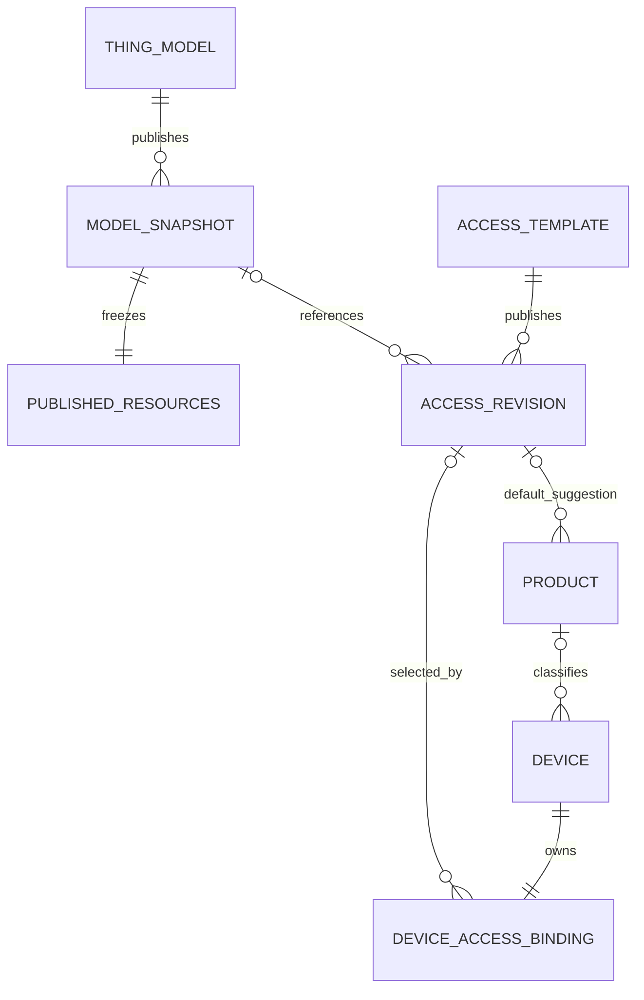
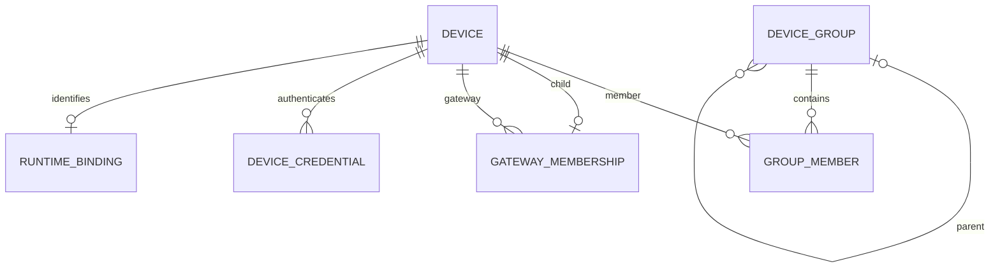

# 领域模型与责任边界

> 2026-10-25已按当前三仓源码重新复核；本轮增量、Git状态与证据边界见[REVIEW-2026-10-25.md](REVIEW-2026-10-25.md)。原2026-10-23证据保留其历史日期。唯一目标合同已修订为2.0.0-plan.4；内部引用协议见API-CONTRACT §10.1。

版本：2026-10-23 / 规划基线。入口：[TASKS.md](TASKS.md)；权威 wire contract：[openapi.yaml](openapi.yaml)；字段/约束：[DATABASE.md](DATABASE.md)；事实证据：[EVIDENCE.md](EVIDENCE.md)、[INVENTORY.md](INVENTORY.md)。本文件定义目标，不声称已经实现或上线。

main-1.3.0物模型已合并且用户确认模板创建设备正常；自动化告警由另一个任务做完后才接调用；企业版产品管理/扫码激活不属于社区版。交接见[并行协作边界](PARALLEL-COORDINATION-2026-10-25.md)，不是第二份API合同。

## 1. 先解决三种“模板”的混名

当前 Community 路由 `device_config` 的浏览器 URL 是 `/device/template`，实际组件 `src/views/device/config/index.vue`，调用 `GET /device_config`。`device_template` 路由的浏览器 URL 则为 `/device/thingsmodel`。后端旧 `device_configs` 负责协议、凭据策略、连接方向、自动注册与接入配置；旧 `device_templates` 负责物模型及 Web/App 图表等展示资料。Encore 现有 `device_templates` 又是带固定模型 snapshot 指针的接入模板。**这三者不能按表名直接一一照搬。** 证据：F `src/router/elegant/routes.ts:279-396`、`src/router/device-route-mapping.ts:4-19`；B `internal/model/device_configs.gen.go:14-32`、`device_templates.gen.go:14-31`；K `encore-api/devicemetadata/models.go:91–123`。

本方案菜单仍称“设备模板”，领域实体统一命名 **设备接入模板 DeviceAccessTemplate**。在既有 Encore `devicemetadata` 内演进该实体，将现有 `device_templates` 受控更名/演进为 `device_access_templates`；不同时保留另一套模板 CRUD。接入配置是其单份当前值对象，也可由合法无模板设备持有，不另设“接入配置服务”。

## 2. 术语 → 唯一定义 → API → 实体/表 → owner

|术语|唯一定义|正式 API / operation|实体或表|唯一责任服务|
|---|---|---|---|---|
|设备 Device|租户拥有的可管理设备身份及期望生命周期，UUID身份与业务编号分开|`/api/v2/devices`、`changeDeviceNumber`|`devices`；关系见下文|既有 `devicemetadata`|
|设备编号 DeviceNumber|租户内可审计修改的业务编号；不直接等同数据库ID、MQTT ClientID或外部服务设备号|`checkDeviceNumber`、`changeDeviceNumber`|`devices.device_number`及改号预留/作业|`devicemetadata`；runtime负责采用新标识|
|产品 Product|可选产品目录与 product key、SKU、型号及默认接入模板建议关系；旧动态注册实际使用 product key|`listProducts`、`getProduct`|复用 `products`|既有 `devicemetadata` 的产品能力；本次不扩展无关产品管理菜单|
|设备模板 DeviceAccessTemplate|一组可复用、直接保存的当前设备接入规则及可选已发布物模型选择；名称/品牌等是描述信息|`/api/v2/device-access-templates`|`device_access_templates`，演进当前 Encore `device_templates`|`devicemetadata`|
|物模型 ThingModel|设备遥测/属性/事件/COMMAND的语义草稿，类型、标识符和能力由已实现核心验证|既有 `/api/v2/thing-models`、`/api/v2/thing-model-commands/*`|既有 `thing_models`、`thing_model_items`|既有 `thingmodel` core/app；本次复用|
|物模型发布快照|指定 model + published revision 的不可变语义，以及同次发布固定的展示资源|`getThingModelVersion`|既有 `thing_model_snapshots`；资源快照沿用0016设计|`thingmodel`|
|物模型展示资源|profile、Web/App图表、展示关联资料，属于现有presentation层，不能塞进语义字段|`getThingModelResources`、`updateThingModelResources`；历史取 Version|既有 `thing_model_resources`及snapshot资源内容|`thingmodel` 的既有资源能力|
|接入配置 AccessConfiguration|接入方式、连接方向、协议/provider/schema版本、非秘密参数、凭据策略和在线判定策略|TemplateConfiguration / DirectAccess 值对象|模板当前configuration或 `device_access_bindings.direct_access`|期望配置由 `devicemetadata`；解释/执行由 connector/runtime|
|设备接入绑定|设备期望的当前接入模板或无模板直接配置，以及稳定运行身份和期望generation|`get/setDeviceTemplateBinding`|`device_access_bindings`|`devicemetadata`|
|网关关系|一个设备至多一个父网关；允许网关挂在网关下，也允许子设备；解绑后设备仍存在|`get/setGatewayMembership`、批量关系、`listSubdevices`|`gateway_memberships`|`devicemetadata`；runtime负责路由采用|
|设备分组|用于组织与选择设备的租户树，多对多成员，不天然扩大权限|`/api/v2/device-groups`|`device_groups`、`device_group_members`|`devicemetadata`|
|设备凭据|设备实际接入所需 token/用户名密码/证书的生命周期；摘要、密文/引用和状态受控管理|`.../devices/{id}/credentials`及轮换/撤销/揭示|`device_credentials`（设备owner）|元数据管理事实；runtime认证执行；复用已有密钥设施|
|模板引导凭据|限定用途的动态注册密钥，只授权指定租户/模板的注册，不是管理token|`.../enrollment-credentials`、`enrollDevice`|同一凭据设施的模板owner，device/template XOR|`devicemetadata`管理；runtime可信注册入口验证|
|设备自定义资料|模板定义 String/Number/Boolean及受支持Enum字段，设备保存实例值；不是telemetry/attribute|`customFieldDefinitions`、`Device.customFields`|模板当前configuration定义 + `devices.custom_fields`|`devicemetadata`|
|Topic映射与处理脚本|当前配置内的接入转换规则；六类Lua阶段有明确输入/输出|TemplateConfiguration；`testProcessingScript`|模板当前configuration；执行日志不入此表|配置由 `devicemetadata`，执行/沙箱由 connector-runtime|
|运行状态|连接在线/离线、最后观测、配置应用generation、诊断和连接信息|runtime-state、批量查询、diagnostics、status-history|runtime自有状态/事件存储|既有 device-runtime；元数据不能写online|
|遥测/属性/事件读数|设备观测值、历史与聚合；含观测时间和当时模型身份|readings、latest-reading-deletions、stream|既有telemetry存储和缓存|telemetry owner|
|实际设备命令|依固定模型COMMAND校验，执行即时/延期投递、取消、回执和超时|command-executions|既有control队列/回执|control owner；`thing-model-commands`是模型编辑命令，切勿混同|
|告警/自动化/OTA/市场|各自领域数据与执行；引用设备/模板/模型的稳定身份与版本|通过正式元数据/模型API及其各自正式API|保留各owner自己的业务表|各现有owner；本次只迁引用/消费端，不重写全部领域|
|文件资产|模板图片等受权限控制的文件和内容摘要|file-assets|既有文件owner的对象与元数据；模板仅asset ID|现有文件存储能力|
|一次性迁移映射|源系统实体和ID到目标ID/版本的持久可审计映射|离线迁移runner调用正式API|隔离的迁移账本|升级工具；运行请求不得用它解析旧ID|

## 3. 几个必须保持正交的维度

旧代码的 `A/B` 是两个不同枚举：`devices.access_way` 的 A=协议、B=服务；`device_configs.device_conn_type` 的 A=设备连平台、B=平台连设备。另有 `device_type` 1/2/3。新接口分别用 access mode / connectionDirection / deviceKind 表达，不互相推断。证据：B `devices.gen.go:49`、`device_configs.gen.go:18-22`。

管理状态 `enabled/disabled`、激活状态 `inactive/active`、运行连接 `online/offline/unknown`、配置 `desired/applied generation` 是四件事。保存新配置不等于运行时已应用；MQTT/协议ACK不等于物理执行成功；已有模型发布 `consumerState=PENDING` 也不等于设备已切版。不同状态必须在UI、CLI和测试报告中分别显示。

新建元数据可以暂未激活；标准创建流程要完成凭据与激活用例后才显示可接入。旧CreateDevice默认active/enabled是已核实行为，存量迁移必须保留。新用户流程、旧“仅一根组自动归组”和禁用中的按编号激活入口由 [DECISIONS.md](DECISIONS.md) 的D-PRODUCT-004闭合，不能悄悄改变默认。

## 4. 关系图

### 4.1 模型与接入版本

设备绑定的是**当前设备模板ID**，并共享模板当前选定的**已发布物模型版本**及其不可变资源快照。模板显式改选物模型版本影响关联设备；物模型单独发布新版不会自动改选模板。产品默认模板只给选择器建议，创建设备要显式选择。没有模板的设备可使用合法的 DirectAccess；没有模型的设备保留无模型，不补造空产品/空模型。无模板但尚无接入配置的预登记设备可以管理，不能凭空宣称已可执行COMMAND。

### 4.2 组织与运行身份

分组层级与网关层级完全不同。设备可属多个组；一个组只一个父；一个设备只一个父网关。网关层级允许多级网关。两类树都须事务防环、租户隔离、明确最大深度；不能因为列表排序不同而丢子树。

## 5. 唯一事实源与跨服务一致性

- `devicemetadata`写设备管理信息、关系和期望配置；`thingmodel`写核心语义/发布资源；其他服务不得直接SQL修改这些事实。
- 当前两个Encore能力共用 `device_metadata` 数据库资源。可在同一数据库对固定模型引用加租户复合FK，但表的写owner仍保持唯一；跨独立数据库的runtime/alarm/OTA引用用正式API和持久引用/fence协议，不伪造跨库FK。
- 设备期望generation与outbox同事务提交；runtime按deviceId+generation去重、拒绝旧generation，并返回applied状态。设备详情展示期望，控制只能在已应用且模型一致的版本下执行。未知状态宁可明确pending/503，不能回读旧表掩盖失败。
- 删除先建立持久删除fence，禁止新引用，联系外部owner确认可删除；活跃引用409，依赖无法确认503/待处理。确认隔离接入与凭据撤销后才tombstone。任何时候不由metadata删除遥测历史。
- 秘密材料不得出现在模板包、设备普通详情、列表、审计或日志。可恢复凭据只在独立权限/用途和审计下揭示；不可恢复凭据只能轮换。没有现有Vault时不为了本功能新造服务；部署密钥保护、密钥轮换和有效期是实现任务。
- runtime identity保留provider/namespace/externalId，保证历史连续。源旧ID存在迁移账本，不成为日常旧表resolver。

## 6. 物模型复用边界

复用 `K@37fbb5e/encore-api/thingmodel/{core,app,transport,postgres}` 中已经成立的类型验证、CAS、固定snapshot、资源发布、幂等收据、事务审计/Outbox及测试。已知需要补的都是可定位的接线：可信身份统一、当前metadata租户归一化碰撞处理、`modelID`→`modelId`等wire统一、data/meta和Problem、严格分页、读取真实presentationRevision、向版本响应暴露已有resourcesChecksum、三菜单/消费者固定版本引用。

语义checksum不包含图表，且计算包含源tenant/model/revision；导出包完整性hash、源语义checksum、新导入后发布checksum、resourcesChecksum是四种不同证据。不能要求重分配ID后的语义checksum与来源相同，也不能仅凭不含tenant的HTTP SnapshotDetail声称离线重算了源语义hash。见API-CONTRACT和DM-API-007。

历史10/20文档部分迁移保留投影/适配的建议与本轮用户边界冲突，**本轮明确不采用**。现有 `legacy_projection_port`、`l3-core/devices`旧代理、旧migration公开入口和CLI project-runtime都只作审计/离线转换参考，不进目标运行架构。

配置事件的desiredActivationState是接入意图，设备activationState是已确认事实；inactive意图不能因已有凭据而自动变active。凭据运行解析仍由现有metadata凭据owner的受限private用例负责，不增加凭据模块；唯一定义见API-CONTRACT及OpenAPI扩展。
