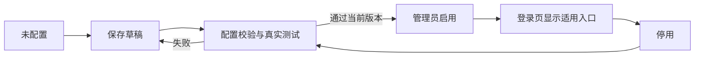

# 认证现状审计与产品配置调研

调研日期：2026-10-26（Asia/Shanghai）。范围：社区后端 `main-1.3.0`、社区 Web `main-1.3.0`、App `main`，原认证 v4 资料与仓库 v5 方案。本文为审计结果和建议合同，不是功能已经完成或生产安全验收通过的声明。

## 1. 结论

第三方登录应当由管理员先配置、验证、启用，再按适用终端和范围显示给用户。基础账号认证必须正常提供服务；“是否启用微信/企业登录”与“由 Gin 还是 Encore 签发平台会话”是两种不同决策，不能混成一个产品开关。

目前协议适配、绑定和会话代码已有基础，但缺少完整的认证配置管理流程。截图中的警告有明确代码与运行原因：Web 无条件请求可选认证入口，404/503 均被显示为整个平台“认证服务暂不可用”。它不能证明密码登录失败，也不能代表管理员主动关闭了第三方登录。

建议保留原用户、租户、权限和显式绑定基础，补齐配置生命周期、来源故障隔离、公开登录选项合同和管理员诊断。当前没有证据支持再次更换认证框架或强制部署 Casdoor。

## 2. 截图警告的实际原因

### 2.1 已复核的本地响应

| 入口 | 实际结果 | 含义 |
| --- | --- | --- |
| Web `/proxy-default/auth/external/providers` | HTTP 404，`404 page not found` | 该开发代理仍指向 Gin，Gin 没有这个新接口 |
| Encore `/api/v1/auth/external/providers` | HTTP 503，`authentication unavailable` | 当前 `TP_AUTH_MODE=legacy-jwt`，原生认证未启用，处理器仍调用 `authcore.Load()` |
| 本地账号密码登录 | 前一轮浏览器实际登录成功 | 密码入口正常与第三方列表失败可以同时发生 |

这些结果只描述本机运行环境，不代表线上站点同样配置。

### 2.2 代码调用链

1. Web `src/views/_builtin/login/modules/pwd-login.vue:260` 无条件挂载 `ExternalAuthPanel`。
2. `src/components/auth/external-auth-panel.vue:109` 在挂载时请求第三方列表。
3. 同文件 115—117 行把任何异常归为 `unavailable`；183—184 行即使没有任何第三方按钮，也会单独渲染黄色警告。
4. `src/service/api/external-auth.ts` 通过现有默认业务代理定位认证接口；当前该代理去 Gin。
5. 后端 `encore-api/l1-access/authn/endpoints.go:8` 对所有认证请求先加载完整原生运行时；关闭原生模式也会返回 503。

因此，单独把请求转发至 Encore 还不够；还必须定义“未启用”和“发生故障”各自的合同。仅删除提示文字也不能解决接线和管理缺口。

## 3. 现状问题与优先级

以下区分实际响应、静态代码发现、产品缺项；静态发现不冒充本轮已经做过故障注入。

| 优先级 | 发现 | 代码依据 / 证据 | 影响 |
| --- | --- | --- | --- |
| P0 | 可选来源错误与基础认证初始化耦合 | `encore-api/internal/authcore/runtime.go:97`，任一来源无效或 ID 重复即返回整体错误；`authn/service.go` 原生模式启动时加载整个运行时 | 原生模式下，一个可选来源的错误配置可使 authn 初始化失败，波及密码登录。这是静态代码结论 |
| P0 | 部署切换不是完整闭环 | 前端请求默认代理；`TP_AUTH_MODE`、Gin `TP_AUTH_OWNER`、网关路由分别控制 | 容易出现旧登录工作、新认证 404/503，或重复会话写入者；不能让用户在后台点开关来完成技术迁移 |
| P0 | Web“记住我”保存可还原密码 | `pwd-login.vue:104` 的 `btoa` 与 134 行的 `atob`；在 `origin/master` 也存在 | 属于遗留问题；Base64 不是加密，不能继续把保存密码当作记住登录状态 |
| P1 | 无逐来源启停、显示与测试状态模型 | `ProviderConfig` 有 ID/标签/协议/凭据/租户/ReviewID，没有 enabled、展示范围和已发布版本状态 | 加入配置列表就相当于启用，缺少安全、可理解的管理流程 |
| P1 | 没有第三方认证配置后台 | 现有 `management/auth` 实际是菜单/权限管理；新 authn 接口只有登录、绑定等运行接口 | 管理员看不到配置入口、错误原因及验证记录 |
| P1 | 配置不能动态生效 | `runtime.go:43` 使用 `sync.Once`，提供方从私密文件一次加载 | 新增后台开关不能只更新数据库或前端；必须设计后端加载、版本与生效反馈 |
| P1 | 公开提供方列表没有显式登录场景合同 | `http.go:128` 返回整个配置列表的 ID/label/kind；Web/App 各自过滤 kind | 终端、站点/租户策略和展示顺序缺少统一服务端判定；登录时仍须独立校验授权范围 |
| P1 | Web 与小程序错误处理不一致 | Web 列表失败显示泛化警告；App `loadMiniProviders()` 失败直接清空 | 一边像整站故障，一边又无法区分未启用与网络失败 |
| P1 | 管理员诊断不足 | `runtime.go` 多种配置故障都返回 `ErrUnavailable`；公开处理器统一 503 | 公网错误可保持简洁，但后台必须能区分密钥、路由、来源配置、Redis、DB 等问题 |
| P1 | 绑定管理不完整 | 已有本人绑定/解绑与管理员停用 API，但没有专门管理员绑定管理页面 | 紧急停用、恢复与用户支持缺少正常产品入口 |

OWASP 建议避免把敏感信息存入 localStorage，指出同源脚本或 XSS 可以读取其中的数据。移除可还原密码是直接修复；整个 Web 会话改为 HttpOnly Cookie 需要另列兼容评估，不能顺手替换 App 的 Bearer 合同。[OWASP HTML5 Security](https://cheatsheetseries.owasp.org/cheatsheets/HTML5_Security_Cheat_Sheet.html#local-storage)

32 字节密钥要求本身不是应当放宽的错误。升级时应检查现有部署、准备强密钥与会话失效安排，并让所有校验方同步；不能为了启动绕过检查，也不能只改一处导致旧会话和通知身份失配。

## 4. 与原方案的关系

原始 v4 任务书已经要求：

- “认证关闭时不联系外部来源；启用配置错误时该来源拒绝并给管理员诊断。”
- 提供方列表只展示本部署已启用且可用的入口。
- 网页保留原账号；第三方绑定后仍进入原用户、租户和资产。
- 同一应用拥有会话，不能为新认证另建用户库和生产认证应用。

v5 继续要求登录页只显示已经配置且适用于当前终端的入口，并明确网站微信默认关闭、企业来源按需启用、Casdoor 可选。

这些方向可以保留。此前文档较侧重协议、安全和迁移，没有把管理员配置页、逐来源状态、测试生效过程和普通用户的故障体验定义成可验收产品合同。当前代码又没有完整兑现来源故障隔离。此次需要补齐上述缺口，不能把问题全部归结为本机少配了几个变量。

原资料位置：用户提供的《ThingsPanel认证设计-v4》目录下 `docs/设计/多认证最小原型开发任务与实施顺序-2026-10-21.md`；仓库内 v5：`统一认证实施方案-v5-20261023.md` 与 `../认证接入运行手册-v5.md`。

## 5. 成熟产品的实际做法

这里比较官方公开配置行为，没有声称已部署三套产品并完成实机比较。在线 latest 文档可能随产品发布变化；本次读取日期为 2026-10-26。

| 产品 | 官方可核实的做法 | ThingsPanel 应借鉴的部分 |
| --- | --- | --- |
| ThingsBoard CE | 认证客户端保存提供方凭据/映射，域名关联客户端；管理表展示启用状态，域名可切换 OAuth 启用 | 明确后台入口、来源启用状态及站点适用范围 |
| Grafana Generic OAuth | `enabled` 默认 false；配置客户端及回调后开启；提供显示名称等选项 | 默认关闭，配置与展示有明确关系，保留本地登录 |
| Grafana SAML UI | 提供测试/启用和停用操作；该能力的官方页面标注 Enterprise/部分 Cloud 计划 | 借鉴配置验证与明确生效反馈，不因此扩大本期到原生 SAML |
| Keycloak | 来源配置区分启用、隐藏登录入口和仅供账号关联；账号关联另有流程 | 区分认证连接、入口展示和账号绑定 |

来源与边界：

- [ThingsBoard OAuth 2.0](https://thingsboard.io/docs/user-guide/security/oauth-2-support/)：采用其配置与站点模型，不照抄自动创建用户/租户等示例策略。
- [Grafana Generic OAuth](https://grafana.com/docs/grafana/latest/setup-grafana/configure-access/configure-authentication/generic-oauth/)：文件配置是合理运维方式；缺少 UI 不自动构成协议漏洞，但不满足当前要求的可管理产品体验。
- [Grafana SAML UI](https://grafana.com/docs/grafana/latest/setup-grafana/configure-access/configure-authentication/saml/saml-ui/)：这里只引用交互流程，不能把付费版能力写成 OSS 的既定能力。
- [Keycloak Server Administration](https://www.keycloak.org/docs/latest/server_admin/index.html#_identity_broker)：借鉴状态拆分，无需为此强制引入 Keycloak。

共同启示是：来源是否配置、管理员是否允许使用、在哪里显示、运行是否正常，应该分别表达。ThingsPanel 的登录页也应表达用户可执行的登录动作，部署迁移状态应放在管理员诊断中。

## 6. 推荐的产品结构

### 6.1 三个用户位置

| 位置 | 使用者 | 内容 |
| --- | --- | --- |
| 系统管理 → 安全设置 → 登录与认证 | 平台管理员 | 登录方式、第三方连接配置、测试与启停、适用范围、脱敏诊断、变更审计 |
| 个人中心 → 账号安全 → 第三方账号 | 当前用户 | 已绑定来源、绑定、解绑及必要的再次验密；不出现 AppSecret 等配置 |
| 登录页 | 未登录用户 | 本地账号表单，及当前终端/站点允许的第三方按钮；不展示后台技术开关 |

现有 `management/auth` 菜单权限页继续负责授权管理，不应直接拿“auth”路径来混放身份来源设置。通知渠道插件、设备认证和人员登录也应保持各自明确的产品位置。

### 6.2 谁能配置

首期：平台管理员配置来源、持有密钥与决定租户范围；租户管理员只管理本租户成员绑定的停用/恢复，不能读取平台来源秘密或跨租户授权。普通用户只处理自己绑定。

未来客户需要独立企业 IdP 时，再做租户级连接配置、委派权限和独立组织登录入口。不能只添加一个客户端可传的 tenantId，就把它当成租户授权依据。

### 6.3 首期登录方式

| 方式 | 当前推荐默认 | 用户入口 |
| --- | --- | --- |
| 本地账号密码 | 保留可用 | Web、App、小程序 |
| 微信小程序登录 | 未配置/未验证时关闭 | 仅该微信小程序 |
| 企业 OIDC | 默认关闭，确有企业来源再配置 | 首期 Web；App 系统浏览器 OIDC 需独立验收 |
| 网站微信扫码 | 默认关闭，独立应用资质和凭据 | Web；不能复用小程序 Secret 当网站凭据 |
| 原生 App 微信登录 | 本期不新增 | 不把小程序适配器显示在原生 App 中 |
| 新增短信/邮箱验证码、Passkey、MFA、强制 SSO | 独立需求 | 不因本次修复同时加入全部模式；已有入口保持原合同并单独验收 |

没有企业身份系统时，不需要安装 Casdoor 来启用小程序。以后接入 Casdoor/Keycloak 时按 OIDC 来源处理，不让用户和设备资产迁入另一套账号库。

## 7. 管理员配置与生效流程

建议的最小流程：



运行健康状态单独记录为“未知、正常、异常”，不要把瞬时网络异常直接改写成管理员停用，也不要把 HTTP 200/能访问授权页面当作真实登录测试成功。

建议列表列：方式、显示名称、适用终端、适用范围、配置状态、启用状态、最近测试、运行状态、操作。默认卡片或列表控制在账号密码、微信小程序、企业登录、网站微信四项，尚未做的模式不要堆满页面。

操作包括配置、校验、测试指引/测试登录、启用、停用、查看脱敏诊断。启用要求基础字段、HTTPS/回调、作用范围和当前配置版本的测试记录满足要求；仅填写一个 `reviewId` 文本不等于完成真实验收。

### 7.1 微信小程序配置

普通字段：内部 ID、显示名称、AppID、适用租户。AppSecret 输入后只显示“已配置”和可选的末次更新时间；不在读取接口中返回原值。显示已配置的服务域名和小程序后台配置指引。

校验不能通过浏览器直接拿 AppSecret 请求微信。没有真实临时 code 时，系统最多能证明字段格式与本地依赖正常，不能标成真实微信登录已验证。测试需由小程序取得新 code，在后端完成换码与身份处理。

正式小程序上线仍需满足微信平台域名、HTTPS、隐私与审核要求；开发者工具测试不等于发布验收。微信官方登录页本次抓取失败，不能声称已重新核实全部最新平台政策。[微信登录文档入口](https://developers.weixin.qq.com/miniprogram/dev/framework/open-ability/login.html)。uni-app 当前官方文档也明确区分不同终端的登录凭据，不能把 App 的返回值/配置原样当作小程序合同。[DCloud uni.login](https://uniapp.dcloud.net.cn/api/plugins/login.html)

### 7.2 企业 OIDC 配置

普通字段：显示名称、Issuer、Client ID、适用站点/租户；秘密字段：Client Secret。回调地址由系统公开地址生成并提供复制。优先通过服务端从受信 Issuer 获取发现信息，端点细节折叠为高级配置，并校验发现文档 Issuer 一致。元数据抓取和后台测试同样需要 SSRF 防护，不能因操作者是管理员就允许任意内网探测。

OIDC 继续使用授权码流程、PKCE S256、state/nonce、服务端校验签名和 iss/aud/exp/sub；回调精确登记，不允许任意外部返回地址。OAuth 2.0 安全 BCP 和 OIDC Core 支持这些协议约束，但它们不规定管理员页面必须长什么样；本文 UI 是产品建议。[RFC 9700](https://www.rfc-editor.org/rfc/rfc9700.html#section-2.1)、[OIDC Core](https://openid.net/specs/openid-connect-core-1_0.html#IDTokenValidation)

### 7.3 配置保存与秘密管理

目标是一个权威配置源：在现有账号组件管理的数据库内保存提供方配置/版本/状态/审计，秘密在服务端加密保存或保存秘密管理系统引用；部署注入加密主密钥。原有私密配置文件作为受控导入入口，不能与 UI 各维护一份可写配置。

如果部署选择完全由配置文件/IaC 管理，后台显示“由部署配置管理”，只读并提供诊断，不放一个实际上无法生效的开关。首期后台需明确实现其中一种管理模式，而不是隐式混用。

修改草稿不破坏正在运行的已发布配置；启用时按版本校验并原子替换已发布快照，后端返回实际生效版本。所有实例应一致加载；更新失败保留上一份经过验证的活动配置并给管理员明确错误，不悄悄降级到弱验证。

## 8. 登录页应该如何表现

| 场景 | 预期表现 |
| --- | --- |
| 没有启用任何第三方方式 | 只有原账号密码表单，不显示空分隔线、配置提示或黄色“认证服务”警告 |
| 只启用小程序微信，当前在 Web | Web 保持原表单；小程序才显示微信入口 |
| Web 企业登录已启用 | 密码表单下显示“其他登录方式”和具体名称按钮 |
| 某个已启用来源临时故障 | 在该来源交互范围显示“企业登录暂不可用，可使用账号密码登录”及重试；不暗示密码入口已故障 |
| 用户点击后取消/授权失败 | 留在或返回正常登录页，给该次操作提示；不进入伪登录状态 |
| 基础密码认证本身不可用 | 显示登录服务不可用及可执行的重试/联系管理员指引；禁止静默绕过校验 |
| 第三方列表请求失败，无法确认配置 | 与“未启用”分开记录；仅隐藏可选入口作为显示层降级，不把异常宣称为主动关闭；后台/日志保留可诊断错误 |

登录选项应通过当前部署中唯一权威的公开接口返回。建议新增 `GET /api/v1/auth/login-options?channel=web`（终端可为 web/mp-weixin/app），旧 providers 接口在迁移期从同一已发布快照生成。建议的新合同如下，尚未实现：

```json
{
  "code": 200,
  "data": {
    "password": { "enabled": true },
    "external": { "enabled": false, "providers": [] }
  }
}
```

已启用来源只返回公开 ID、名称、kind、允许的显示方式等。不能返回 Secret、内部端点、租户成员表或真实故障堆栈。终端参数只能用于呈现，不构成服务端身份或访问授权；调用登录/绑定时仍再次检查来源状态、配置版本、租户和账号。

明确停用时应返回稳定的空入口结果；真实依赖故障仍返回错误。原生模式下基础密钥/DB/Redis 等失败必须按基础认证故障处理，不能为了消除黄色提示恢复旧的弱签名或绕过权限。

Web、小程序、个人中心共用同一状态语义。个人中心在全局未配置时显示简洁空状态，不让用户填写平台密钥；已绑定但被停用的来源应保留状态可见，不能因为当前入口列表为空就把历史绑定丢掉。

## 9. 停用、绑定与现有会话的语义

| 动作 | 建议规则 |
| --- | --- |
| 停用一个提供方 | 立即禁止该来源的新登录与绑定，并使其未完成事务不可继续；保留绑定记录和资产。该动作不应无提示地注销全站全部用户 |
| 管理员停用某个账号绑定 | 继续使用认证版本撤销该用户会话与 App 推送资格，并明确影响范围、记录审计 |
| 用户主动解绑 | 必须再次验密，并在确认前明确当前实现会退出所有设备；更细的按来源会话撤销需额外保存来源信息，不能假称已经具备 |
| 更换 Issuer/AppID | 按新的身份空间处理，不能重用旧 subject/OpenID 直接认领用户；变更使旧测试和待完成事务失效 |
| 停用用户 | 所有相关来源都不能绕过本地停用；退出和推送设备资格继续联动 |

来源停用默认只阻止后续进入；是否还要强制退出已登录会话，是需要显式实现的独立策略。对安全事件可采用现有按用户撤销全部会话的保守能力；当前不能承诺按提供方精准清理，因为平台会话未完整记录来源维度。

保留显式绑定和账号范围校验，不按相同邮箱/手机号自动合并。首期不开放第三方自动创建管理员/租户/用户。企业强制 SSO、离职自动同步和单点退出属于后续独立能力。

平台必须保留受控的本地管理员恢复能力，避免第三方故障导致无人能进入配置后台。本期不提供随意关闭最后一个本地管理员登录入口的开关。

## 10. 实施顺序与验收

### 第一批：恢复默认体验与故障边界

1. 定义并接通公开登录选项，明确未启用、未配置、来源异常和基础认证异常。
2. 移除可选入口失败时的全局泛化警告；保留点击后按来源显示的错误、重试与后台诊断。
3. 可选提供方草稿/坏配置不能使基础认证初始化失败；不能削弱基础认证依赖失败时的拒绝行为。
4. 加入部署预检：认证所有者、路由、密钥、schema、Redis、会话版本、通知资格消费者必须匹配。技术切换由部署流程完成，不伪装成产品开关。
5. 移除 Web 可还原密码保存和旧值；合理支持浏览器密码管理器。长期登录会话策略另做明确设计。

### 第二批：补齐管理员配置

完成平台管理员页面与受权 API、逐来源状态、服务端秘密保护、真实测试记录、原子启停、生效版本、审计和成员绑定支持入口。缺任一生效链路时不能只交付一个好看的开关。

### 第三批：按实际需求启用

先验证微信小程序和原账号共存；企业 OIDC、网站扫码在提供真实来源后分别验收并启用。Casdoor 保持可选。每一批都有可验证结果，避免同时替换框架、账号系统、全站会话和所有登录方式。

### 最低验收矩阵

| 测试 | 必须结果 |
| --- | --- |
| 全新安装、第三方全部关闭 | 原管理员初始化/密码登录成功，无截图中的黄色警告 |
| 原账号升级 | 用户 ID、租户、角色与资产归属一致，App 原登录仍可用 |
| 只配置但不启用 | 公共登录页不出现该按钮，不可通过直接调用绕过状态 |
| 配错一个可选来源 | 管理员得到对应诊断，原密码登录保持正常 |
| 改动测试通过后的配置 | 旧测试记录失效；启用针对确切新版本 |
| 停用与回调并发 | 待完成事务不能绕过停用或配置版本校验 |
| 微信配置只适用小程序 | Web/原生 App 不出现错误类型入口 |
| 未绑定微信/OIDC | 不发平台会话、不自动认领同邮箱账号，能取消绑定流程 |
| 来源停用后查看个人中心 | 历史绑定保留并正确显示不可用原因 |
| 跨租户/低权限操作 | 无法读取、编辑其他租户连接或密钥；无超管权限提升 |
| 密钥和诊断 | 读取接口、前端产物、审计、trace、日志不含 Secret/密码/完整凭据 |
| 记住账号与登录 | localStorage 不再保存可还原密码，登录页支持浏览器自动填充 |
| 会话撤销与 App 推送 | 单登/共享、退出/冻结/解绑后设备资格遵守同一会话规则 |
| 生产迁移 | 前后端版本和路由匹配，只有一个会话写入者，完成升级与受控回退演练 |

以上矩阵是待实施验收要求。本轮只完成源码审计、公开接口状态复核和官方资料调研，没有再次修改认证业务代码，也没有启用真实来源。前一轮的迁移换行修复仍是独立未提交改动，不能与本报告混称为认证产品已经修复。
